# Guia Completo e Didático de Normalização de Banco de Dados

Este resumo estruturado sintetiza de forma detalhada e didática todo o conteúdo dos materiais de aula presentes no diretório (`Banco de Dados - slides_dependencia.pdf`, `Banco de Dados - 1fn-slides.pdf`, `Banco de Dados - 2fn-slides.pdf`, `Banco de Dados - 3fn-slides.pdf` e `normalization.pdf` — *Sistemas de Banco de Dados*, Cap. 5).

---

## Sumário

1. [Introdução: O que é Normalização e Por Que Precisamos Dela?](#1-introdução-o-que-é-normalização-e-por-que-precisamos-dela)
2. [As Anomalias de Dados (Inserção, Alteração e Exclusão)](#2-as-anomalias-de-dados-inserção-alteração-e-exclusão)
3. [Fundamentos: Dependências entre Dados](#3-fundamentos-dependências-entre-dados)
   - [3.1. Dependência Funcional (`A → B`)](#31-dependência-funcional-a--b)
   - [3.2. Dependência Funcional Total (Chave Composta)](#32-dependência-funcional-total-chave-composta)
   - [3.3. Dependência Parcial](#33-dependência-parcial)
   - [3.4. Dependência Transitiva](#34-dependência-transitiva)
   - [3.5. Dependência Multivalorada (`A →→ B`)](#35-dependência-multivalorada-a--b)
   - [3.6. Quadro Resumo das Dependências](#36-quadro-resumo-das-dependências)
4. [Visão Geral das Formas Normais](#4-visão-geral-das-formas-normais)
5. [1ª Forma Normal (1FN) — Atomicidade e Fim dos Grupos Repetitivos](#5-1ª-forma-normal-1fn--atomicidade-e-fim-dos-grupos-repetitivos)
   - [5.1. Violação 1: Múltiplos Valores em uma Única Célula](#51-violação-1-múltiplos-valores-em-uma-única-célula)
   - [5.2. Violação 2: Grupos Repetitivos de Colunas](#52-violação-2-grupos-repetitivos-de-colunas)
   - [5.3. Como Colocar uma Tabela na 1FN](#53-como-colocar-uma-tabela-na-1fn)
   - [5.4. Nuance Fundamental: Atomicidade Depende do Contexto](#54-nuance-fundamental-atomicidade-depende-do-contexto)
6. [2ª Forma Normal (2FN) — Eliminação de Dependências Parciais](#6-2ª-forma-normal-2fn--eliminação-de-dependências-parciais)
   - [6.1. Regra de Ouro da 2FN (Chave Simples vs. Chave Composta)](#61-regra-de-ouro-da-2fn-chave-simples-vs-chave-composta)
   - [6.2. Problemas Causados pela Violação da 2FN](#62-problemas-causados-pela-violação-da-2fn)
   - [6.3. Passo a Passo para Converter para a 2FN (Exemplos Práticos)](#63-passo-a-passo-para-converter-para-a-2fn-exemplos-práticos)
7. [3ª Forma Normal (3FN) — Eliminação de Dependências Transitivas](#7-3ª-forma-normal-3fn--eliminação-de-dependências-transitivas)
   - [7.1. Problemas Causados pela Violação da 3FN](#71-problemas-causados-pela-violação-da-3fn)
   - [7.2. Passo a Passo para Converter para a 3FN (Exemplos Práticos)](#72-passo-a-passo-para-converter-para-a-3fn-exemplos-práticos)
   - [7.3. Comparativo Direto: 2FN vs. 3FN](#73-comparativo-direto-2fn-vs-3fn)
8. [Formas Normais de Nível Superior: BCNF e 4FN](#8-formas-normais-de-nível-superior-bcnf-e-4fn)
   - [8.1. Forma Normal de Boyce-Codd (BCNF)](#81-forma-normal-de-boyce-codd-bcnf)
   - [8.2. Quarta Forma Normal (4FN)](#82-quarta-forma-normal-4fn)
9. [Estudo de Caso Completo: Da Tabela Não Normalizada ao Banco Refinado (ConstructCo)](#9-estudo-de-caso-completo-da-tabela-não-normalizada-ao-banco-refinado-constructco)
   - [9.1. Estado Inicial (Relatório / Formato Tabular Não Normalizado)](#91-estado-inicial-relatório--formato-tabular-não-normalizado)
   - [9.2. Etapa 1: Conversão para 1FN e Diagrama de Dependências](#92-etapa-1-conversão-para-1fn-e-diagrama-de-dependências)
   - [9.3. Etapa 2: Conversão da 1FN para a 2FN](#93-etapa-2-conversão-da-1fn-para-a-2fn)
   - [9.4. Etapa 3: Conversão da 2FN para a 3FN](#94-etapa-3-conversão-da-2fn-para-a-3fn)
   - [9.5. Aprimorando o Design Pós-3FN (Boas Práticas de Engenharia)](#95-aprimorando-o-design-pós-3fn-boas-práticas-de-engenharia)
10. [Normalização, Modelagem ER (DER) e Desnormalização](#10-normalização-modelagem-er-der-e-desnormalização)
    - [10.1. Normalização + Diagrama Entidade-Relacionamento (DER)](#101-normalização--diagrama-entidade-relacionamento-der)
    - [10.2. Desnormalização: Quando e Por Que Recuar?](#102-desnormalização-quando-e-por-que-recuar)
11. [Exercícios Resolvidos e Comentados dos Slides](#11-exercícios-resolvidos-e-comentados-dos-slides)
12. [Guia Rápido de Bolso (Cheat Sheet)](#12-guia-rápido-de-bolso-cheat-sheet)

---

## 1. Introdução: O que é Normalização e Por Que Precisamos Dela?

Mesmo após transformar um **Diagrama Entidade-Relacionamento (DER)** em tabelas relacionais, surge uma questão essencial: **como saber se nossas tabelas estão realmente bem organizadas?**

A **Normalização** é o processo formal e progressivo de avaliar, corrigir e decompor estruturas de tabelas (relações) em um banco de dados com o objetivo de:

- **Reduzir redundâncias** (evitar que o mesmo dado seja repetido desnecessariamente em várias linhas ou tabelas);
- **Evitar inconsistências** (impedir que um dado seja atualizado em um lugar e esquecido em outro, gerando informações contraditórias);
- **Eliminar anomalias** de **inserção**, **alteração (atualização)** e **exclusão**;
- **Garantir estruturas adequadas**, nas quais **cada tabela representa um único assunto** (uma única entidade ou relacionamento bem definido) e todos os atributos dependem diretamente de sua chave primária.

> [!IMPORTANT]
> **Princípio Central da Normalização:**
> Cada informação deve ficar armazenada em um único lugar adequado. A normalização atua em uma relação por vez, dividindo progressivamente uma tabela mal estruturada em um conjunto de tabelas menores e bem organizadas (**decomposição**) com base nas dependências identificadas entre os dados.

---

## 2. As Anomalias de Dados (Inserção, Alteração e Exclusão)

Quando uma tabela mistura informações de diferentes assuntos ou possui dependências inadequadas, ela sofre de **redundância de dados**, o que desencadeia três tipos clássicos de **anomalias**:

| Tipo de Anomalia | O que acontece? | Exemplo Prático (Tabela `MATRICULA` com `nome_aluno` ou `ALUNO` com `nome_departamento`) |
| :--- | :--- | :--- |
| **Anomalia de Alteração (Atualização)** | Para modificar um único fato do mundo real, é necessário atualizar **várias linhas** simultaneamente. Se uma linha for esquecida, o banco fica **inconsistente**. | Se a aluna `"Ana"` está matriculada em 5 disciplinas e seu nome foi grafado errado, precisamos alterar 5 linhas. Se o departamento `"Computação"` mudar de nome, é preciso atualizar a linha de cada aluno daquele departamento. |
| **Anomalia de Inserção** | Não é possível cadastrar dados de uma entidade sem antes possuir dados de outra entidade com a qual ela está misturada na tabela (frequentemente porque parte da chave primária seria `NULL`). | Não conseguimos cadastrar um novo **aluno** enquanto ele não estiver matriculado em pelo menos uma **disciplina** (pois `cod_disciplina` faz parte da PK), ou não conseguimos cadastrar um novo **departamento** enquanto não houver nenhum **aluno** nele. |
| **Anomalia de Exclusão** | Ao apagar um registro legítimo, acabamos **perdendo acidentalmente** informações sobre outra entidade que só existiam naquela linha. | Se um aluno trancar a única disciplina em que estava matriculado e apagarmos essa linha de nota, apagamos também o cadastro e o nome do aluno do sistema. Se removermos o único aluno do departamento `"Design"`, perdemos a informação de que o departamento `"Design"` existe. |

---

## 3. Fundamentos: Dependências entre Dados

Antes de aplicar as formas normais, é indispensável compreender como os atributos de uma tabela se relacionam. Toda a teoria da normalização baseia-se no conceito de **dependência**.

### 3.1. Dependência Funcional (`A → B`)

Dizemos que existe uma **dependência funcional** de $A$ para $B$ quando o valor do atributo $A$ **determina unicamente** o valor do atributo $B$.

```text
A → B
```

- **Como ler:** *"$A$ determina $B$"* ou *"$B$ depende funcionalmente de $A$"*.
- **Nomenclatura:**
  - $A$ é chamado de **determinante** (o atributo cujo valor determina outro).
  - $B$ é chamado de **atributo dependente**.
- **O que significa "determinar"?**
  Para um mesmo valor de $A$, **só pode existir um único valor de $B$ (sempre)**.

#### Exemplo Prático: CPF e Nome

| CPF | Nome |
| :--- | :--- |
| 123 | Ana |
| 456 | João |
| 789 | Maria |

Se sabemos o `CPF`, conseguimos descobrir exatamente um `Nome`:
- `CPF → Nome` (Válido: `CPF = 123` sempre terá `Nome = Ana`).
- Nunca pode acontecer em um cadastro íntegro: `123 → Ana` em uma linha e `123 → João` em outra.

#### Propriedades Cruciais da Dependência Funcional

1. **A dependência funcional tem direção (`A → B` $\neq$ `B → A`):**
   Em uma tabela `ALUNO(matricula PK, nome, curso)`:
   - `matricula → nome` (Verdadeiro: uma matrícula identifica um único nome de aluno).
   - `matricula → curso` (Verdadeiro: cada matrícula está vinculada a um curso).
   - `nome → matricula`? **Falso!** Duas pessoas diferentes podem se chamar `"Ana"` e ter matrículas distintas (`101 → Ana` e `103 → Ana`).
   - `curso → matricula`? **Falso!** Um mesmo curso possui vários alunos.

2. **Analise o significado (semântica) dos dados, não apenas a amostra visível:**
   Uma dependência funcional é uma **regra de negócio que vale sempre**, para qualquer instância possível da tabela, e não uma coincidência nas poucas linhas exibidas na tela.
   - *Exemplo:* Em uma tabela de filmes com 3 linhas (`1: Matrix (1999)`, `2: Titanic (1997)`, `3: Matrix Reloaded (2003)`), mesmo que nenhum ano ou título se repita nessas 3 linhas:
     - `cod_filme → título` e `cod_filme → ano` **são** dependências funcionais (o código identifica o filme).
     - `ano → cod_filme` **não é** dependência funcional (vários filmes são lançados no mesmo ano).
     - `título → cod_filme` **não é** dependência funcional (títulos podem se repetir em *remakes* ou obras homônimas).

3. **O Papel da Chave Primária (PK):**
   Por definição, a **chave primária** identifica unicamente cada linha da tabela; logo, a chave primária determina funcionalmente todos os demais atributos da relação:
   ```text
   PRODUTO(cod_produto PK, nome, preco)
   cod_produto → nome
   cod_produto → preco
   ```

---

### 3.2. Dependência Funcional Total (Chave Composta)

Quando uma tabela possui uma **chave primária composta** — formada por dois ou mais atributos, como `(A, B)` —, dizemos que um atributo $C$ possui **dependência funcional total** da chave se ele depende da combinação completa `(A, B)` e **não pode ser determinado por nenhum subconjunto isolado** dessa chave.

#### Exemplo: Notas por Disciplina

```text
MATRICULA(matricula PK, cod_disciplina PK, nota)
Chave Primária Composta: (matricula, cod_disciplina)
```

| matrícula | disciplina | nota |
| :--- | :--- | :--- |
| 101 | BD | 8 |
| 101 | Web | 9 |
| 102 | BD | 7 |

```text
(matricula, disciplina) → nota
```

- Só a `matricula` (`101`) determina a `nota`? **Não**, pois o aluno `101` tirou `8` em BD e `9` em Web.
- Só a `disciplina` (`BD`) determina a `nota`? **Não**, pois em BD o aluno `101` tirou `8` e o aluno `102` tirou `7`.
- Precisamos **dos dois valores juntos** para saber qual é a nota. Logo, `nota` depende **totalmente** da chave composta.

---

### 3.3. Dependência Parcial

A **dependência parcial** ocorre quando a tabela tem uma **chave composta** `(A, B)`, mas um atributo não-chave depende de **apenas uma parte** dessa chave (apenas de $A$, ou apenas de $B$).

#### Exemplo: Misturando Dados de Aluno e Disciplina na Matrícula

```text
MATRICULA(
    matricula PK,
    cod_disciplina PK,
    nome_aluno,
    nome_disciplina,
    nota
)
Chave: (matricula, cod_disciplina)
```

Analisando as dependências:
- `(matricula, cod_disciplina) → nota` (**Dependência Total**: depende da chave inteira).
- `matricula → nome_aluno` (**Dependência Parcial**: para saber o nome do aluno, basta saber a `matricula`; não precisamos saber `cod_disciplina`).
- `cod_disciplina → nome_disciplina` (**Dependência Parcial**: basta o código da disciplina para saber o nome dela).

> [!WARNING]
> **Por que a dependência parcial é um problema?**
> Ela força a repetição de `nome_aluno` em todas as disciplinas que ele cursa e de `nome_disciplina` para todos os alunos matriculados nela, gerando redundância e anomalias. **A 2ª Forma Normal (2FN) existe exatamente para eliminar dependências parciais.**

---

### 3.4. Dependência Transitiva

A **dependência transitiva** ocorre quando um atributo não-chave determina outro atributo não-chave. Ou seja, a chave primária $A$ determina $B$, e o atributo não-chave $B$ determina $C$. Assim, $C$ depende da chave $A$ apenas de forma **indireta (passando pelo meio)**.

```text
A → B   e   B → C    ⟹    A → C (indiretamente / transitivamente)
```

#### Exemplo: Aluno e Curso na Mesma Tabela

```text
ALUNO(
    matricula PK,
    nome,
    cod_curso,
    nome_curso
)
```

```text
matricula → cod_curso → nome_curso
```

- `matricula → cod_curso` (a matrícula do aluno determina em qual curso ele está).
- `cod_curso → nome_curso` (o código do curso determina o nome do curso).
- Logo, `nome_curso` não depende diretamente da `matricula`, mas sim de `cod_curso` (que é um atributo não-chave).

| matrícula | nome | cod_curso | nome_curso |
| :--- | :--- | :--- | :--- |
| 101 | Ana | 10 | Informática |
| 102 | João | 10 | Informática |
| 103 | Maria | 20 | Redes |

- **Problema:** O nome `"Informática"` se repete para cada aluno do curso `10`.
- **Solução:** Separar em duas tabelas ligadas por chave estrangeira (FK):
  - `CURSO(cod_curso PK, nome_curso)`
  - `ALUNO(matricula PK, nome, cod_curso FK)`

> [!WARNING]
> **A 3ª Forma Normal (3FN) existe exatamente para eliminar dependências transitivas.**

---

### 3.5. Dependência Multivalorada (`A →→ B`)

A **dependência multivalorada** acontece quando um único registro ($A$) pode possuir **vários valores independentes** de um determinado atributo ($B$), especialmente quando convivem na mesma estrutura dois ou mais conjuntos de valores independentes entre si.

Representamos com uma seta dupla:
```text
aluno →→ telefone
aluno →→ email
```

#### Exemplo: Aluno com Vários Telefones e Vários E-mails Independentes

Imagine que a aluna **Ana** possua:
- **Telefones:** `9999-1111`, `9888-2222`
- **E-mails:** `ana@gmail.com`, `ana@ifce.edu.br`

Se tentarmos armazenar `aluno`, `telefone` e `email` juntos na mesma tabela (já com valores atômicos), somos obrigados a criar todas as combinações possíveis (produto cartesiano), mesmo que um telefone não tenha nenhuma relação com um e-mail específico:

| aluno | telefone | email |
| :--- | :--- | :--- |
| Ana | 9999-1111 | ana@gmail.com |
| Ana | 9999-1111 | ana@ifce.edu.br |
| Ana | 9888-2222 | ana@gmail.com |
| Ana | 9888-2222 | ana@ifce.edu.br |

- **Como resolver?** Armazenando cada conjunto de valores independentes em sua própria relação:
  - `ALUNO(matricula PK, nome)`
  - `TELEFONE_ALUNO(matricula FK, telefone)`
  - `EMAIL_ALUNO(matricula FK, email)`

---

### 3.6. Quadro Resumo das Dependências

| Tipo de Dependência | Notação | Ideia Principal | Dica Mental para Lembrar 🧠 | Exemplo Clássico |
| :--- | :--- | :--- | :--- | :--- |
| **Funcional (Simples/Total)** | `A → B` ou `(A,B) → C` | Um valor (ou chave inteira) determina um único valor de outro atributo. | *"Um determina o outro."* | `CPF → Nome` / `(matricula, disciplina) → nota` |
| **Parcial** | `A → C` (onde a PK é `A, B`) | Um atributo não-chave depende de **apenas parte** de uma chave composta. | *"Só uma parte da chave determina."* | `matricula → nome_aluno` (em uma tabela de notas) |
| **Transitiva** | `A → B → C` | Um atributo não-chave depende da chave **por meio de outro atributo não-chave**. | *"Vai passando pelo meio."* | `matricula → cod_curso → nome_curso` |
| **Multivalorada** | `A →→ B` | Um registro possui **vários valores independentes** de determinado atributo. | *"Um pode ter vários independentes."* | `Aluno →→ Telefone` e `Aluno →→ Email` |

---

## 4. Visão Geral das Formas Normais

A normalização funciona em estágios progressivos chamados **Formas Normais (FN)**. Cada forma normal herda as exigências da anterior e impõe uma condição adicional sobre a relação:

```mermaid
flowchart LR
    UNF["Tabela Não Normalizada\n(Grupos repetitivos / multivalorados)"] -->|"Valores atômicos +\nSem grupos repetitivos +\nPK definida"| FN1["1ª Forma Normal\n(1FN)"]
    FN1 -->|"Elimina dependências\nparciais (Chave composta)"| FN2["2ª Forma Normal\n(2FN)"]
    FN2 -->|"Elimina dependências\ntransitivas (Não-chave → Não-chave)"| FN3["3ª Forma Normal\n(3FN)"]
    FN3 -->|"Todo determinante\né chave candidata"| BCNF["Forma Normal de\nBoyce-Codd (BCNF)"]
    BCNF -->|"Elimina dependências\nmultivaloradas independentes"| FN4["4ª Forma Normal\n(4FN)"]
```



| Forma Normal | Requisito Principal | O que ela elimina / resolve? |
| :--- | :--- | :--- |
| **1ª Forma Normal (1FN)** | Todos os atributos possuem **valores atômicos**, não há grupos repetitivos e a chave primária (PK) está definida. | Células com múltiplos valores (`"Mouse, Teclado"`) e colunas numeradas repetitivas (`telefone1, telefone2, telefone3`). |
| **2ª Forma Normal (2FN)** | Está na **1FN** e todo atributo não-chave depende funcionalmente da **chave primária inteira**. | **Dependências parciais** (atributos que dependem de apenas parte de uma chave composta). |
| **3ª Forma Normal (3FN)** | Está na **2FN** e nenhum atributo não-chave depende de outro atributo não-chave. | **Dependências transitivas** (atributos que dependem indiretamente da chave através de outro atributo comum). |
| **Boyce-Codd (BCNF)** | Caso especial/mais forte da 3FN: **todo determinante na tabela é uma chave candidata**. | Anomalias raras em tabelas com **múltiplas chaves candidatas sobrepostas** onde um atributo não-chave determina parte de uma chave. |
| **4ª Forma Normal (4FN)** | Está na **3FN (e BCNF)** e não possui múltiplos conjuntos de dependências multivaloradas independentes. | **Dependências multivaloradas independentes** na mesma tabela (`A →→ B` e `A →→ C`). |

> [!TIP]
> **Até onde normalizar na prática?**
> Para a imensa maioria dos bancos de dados transacionais e corporativos, **chegar à 3ª Forma Normal (3FN)** (ou BCNF) já garante um projeto limpo, íntegro e livre de redundâncias prejudiciais.

---

## 5. 1ª Forma Normal (1FN) — Atomicidade e Fim dos Grupos Repetitivos

> **Definição da 1FN:** Uma relação está na **1ª Forma Normal (1FN)** quando **todos os seus atributos possuem valores atômicos** (indivisíveis para o contexto), **não existem grupos repetitivos** e a chave primária está devidamente identificada.

Um **valor atômico** é aquele que representa **um único valor** para aquele atributo em uma determinada célula (interseção de linha e coluna).

Existem **duas formas clássicas de violar a 1FN**:

### 5.1. Violação 1: Múltiplos Valores em uma Única Célula

Considere a tabela de pedidos abaixo:

| pedido | cliente | produtos |
| :--- | :--- | :--- |
| 1001 | Ana | Mouse, Teclado |
| 1002 | João | Monitor |
| 1003 | Maria | Mouse, Teclado, Webcam |

Ou uma tabela de alunos com telefones:

| matrícula | nome | telefones |
| :--- | :--- | :--- |
| 101 | Ana | 9999-1111, 9888-2222 |
| 102 | João | 9777-3333 |

Ou ainda funcionários e suas habilidades:

| funcionário | habilidades |
| :--- | :--- |
| Maria | Python, SQL, Excel |
| Beatriz | Java |

- **Por que isso viola a 1FN?**
  Porque uma única célula acumula **vários valores do mesmo tipo** (`"Mouse, Teclado"`, `"9999-1111, 9888-2222"`, `"Python, SQL, Excel"`). O SGBD não consegue tratar cada produto, telefone ou habilidade como um valor individual diretamente em consultas, filtros, contagens ou chaves estrangeiras.

---

### 5.2. Violação 2: Grupos Repetitivos de Colunas

Na tentativa de ter apenas "um valor por célula", alguém poderia criar colunas numeradas na tabela:

| matrícula | nome | telefone1 | telefone2 | telefone3 |
| :--- | :--- | :--- | :--- | :--- |
| 101 | Ana | 9999-1111 | 9888-2222 | `NULL` |
| 102 | João | 9777-3333 | `NULL` | `NULL` |

- **Cada célula tem um único valor. Isso está na 1FN?**
  **Não!** Colunas como `telefone1, telefone2, telefone3` (ou `produto1, produto2, produto3`, `email1, email2`, `habilidade1, habilidade2`) formam um **grupo repetitivo**: são colunas diferentes representando exatamente o mesmo tipo de informação repetida várias vezes.
- **Por que grupos repetitivos são ruins e violam a 1FN?**
  1. **Não escalam:** Se um aluno tiver 5 telefones, seriam necessárias 5 colunas. Se surgir um aluno com 6 telefones, seria preciso alterar a estrutura da tabela (`ALTER TABLE`) para criar `telefone6`. **A estrutura da tabela nunca deve depender da quantidade de dados!**
  2. **Desperdício e `NULL`s:** Alunos com apenas 1 telefone deixam várias colunas preenchidas com `NULL`.
  3. **Consultas complexas:** Para buscar um telefone, seria necessário testar `WHERE telefone1 = X OR telefone2 = X OR telefone3 = X...`.

---

### 5.3. Como Colocar uma Tabela na 1FN

Existem duas maneiras de transformar uma tabela com atributos multivalorados/grupos repetitivos para que atenda à 1FN:

#### Abordagem A: Desdobrar em uma linha por valor (Achatamento / Flattening)
Colocamos um valor atômico por linha na mesma relação:

| matrícula | telefone |
| :--- | :--- |
| 101 | 9999-1111 |
| 101 | 9888-2222 |
| 102 | 9777-3333 |

- **Atenção à mudança de chave!** Antes, `matrícula` sozinha identificava a linha. Agora que `101` aparece em duas linhas, qual é a chave primária dessa relação?
  - **Resposta:** A chave passa a ser composta: **`(matrícula, telefone)`** (ou `(pedido, produto)` no exemplo de pedidos). *Quando a estrutura muda, a chave muda!*
  - *(Nota: Se essa tabela mantivesse também o atributo `nome` do aluno junto com `(matrícula, telefone)`, ela estaria na 1FN, mas passaria a ter uma dependência parcial `matrícula → nome`, que será resolvida na 2FN ou diretamente pela Abordagem B).*

#### Abordagem B: Decomposição em Duas Tabelas (A Estrutura Ideal)
Em vez de manter tudo em uma única tabela, **separamos o atributo repetitivo em uma nova relação** vinculada por chave estrangeira:

- **Antes (Fora da 1FN):**
  ```text
  ALUNO(matricula PK, nome, curso, telefones)
  -- ou ALUNO(matricula PK, nome, telefone1, telefone2, telefone3)
  ```
- **Depois (Na 1FN — e já bem estruturada):**
  ```text
  ALUNO(matricula PK, nome, curso)
  TELEFONE_ALUNO(matricula FK, telefone)   -- PK composta: (matricula, telefone)
  ```

**Resultado Visual:**

**Tabela `ALUNO`**
| matrícula (PK) | nome |
| :--- | :--- |
| 101 | Ana |
| 102 | João |

**Tabela `TELEFONE_ALUNO`**
| matrícula (FK) | telefone |
| :--- | :--- |
| 101 | 9999-1111 |
| 101 | 9888-2222 |
| 102 | 9777-3333 |

Agora cada célula guarda um único valor atômico, não há colunas `NULL` desperdiçadas e qualquer aluno pode ter 0, 1 ou 100 telefones sem alterar a estrutura do banco!

---

### 5.4. Nuance Fundamental: Atomicidade Depende do Contexto

Um erro comum de iniciantes é achar que a 1FN exige "quebrar absolutamente tudo no menor pedaço possível". **1FN não é "quebrar todo valor composto" — é garantir que cada valor seja único e indivisível para o que o sistema precisa fazer com ele.**

1. **E datas (ex: `nascimento = 15/03/2000`)? Viola a 1FN?**
   - **Não! Está na 1FN.** Embora possua dia, mês e ano, `15/03/2000` representa **um único valor de data** (e os SGBDs possuem tipos nativos `DATE` com funções próprias para extrair ano/mês quando necessário).
2. **E endereços (ex: `endereço = "Rua A, 123, Centro, Itapipoca"`)? Viola a 1FN?**
   - **Depende do contexto do sistema!**
   - Se o sistema **só precisa exibir** o endereço completo na tela ou em uma etiqueta: mantê-lo em uma única coluna `endereço` **está OK e não viola a 1FN**.
   - Se o sistema **precisa consultar, filtrar ou agrupar separadamente** por rua, número, bairro ou cidade (ex: *"listar todos os clientes da cidade de Itapipoca"* ou *"do bairro Centro"*): então é melhor refinar a atomicidade e modelar cada parte em sua própria coluna (`rua`, `numero`, `bairro`, `cidade`).

---

## 6. 2ª Forma Normal (2FN) — Eliminação de Dependências Parciais

Estar na 1FN garante valores atômicos, mas não impede que uma tabela com **chave primária composta** misture fatos que dependem da chave inteira com fatos que dependem de apenas um pedaço dela.

> **Definição da 2FN:** Uma relação está na **2ª Forma Normal (2FN)** quando:
> 1. Está na **1FN**; e
> 2. **Não possui dependências parciais** — isto é, **todo atributo não-chave depende funcionalmente da chave primária inteira**, e nunca de apenas uma parte dela.

### 6.1. Regra de Ouro da 2FN (Chave Simples vs. Chave Composta)

> [!IMPORTANT]
> **A 2FN só é relevante quando a chave primária é COMPOSTA!**
> Se uma tabela tem **chave primária simples** (formada por um único atributo, ex: `ALUNO(matricula PK, nome, curso)`), **não existe "parte da chave"**. Portanto:
> **Toda relação que está na 1FN e possui chave primária simples já está AUTOMATICAMENTE na 2FN!**

Para identificar se uma tabela com chave composta viola a 2FN, faça a seguinte pergunta para cada atributo não-chave:
> *"Esse atributo depende de **toda a chave**, ou eu consigo determinar o valor dele sabendo **só uma parte da chave**?"*
> Se depender de só uma parte $\rightarrow$ é uma **dependência parcial** $\rightarrow$ **viola a 2FN**.

---

### 6.2. Problemas Causados pela Violação da 2FN

Considere a relação de notas abaixo, cuja chave composta é `(matrícula, cod_disciplina)`:

| matrícula (PK) | cod_disciplina (PK) | nome_aluno | nota |
| :--- | :--- | :--- | :--- |
| 101 | D01 | Ana | 8.5 |
| 101 | D02 | Ana | 7.0 |
| 102 | D01 | João | 9.0 |

- **Está na 1FN?** Sim, todos os valores são atômicos.
- **Está na 2FN?** **Não!**
  - `(matrícula, cod_disciplina) → nota` (Depende da chave inteira ✅)
  - `matrícula → nome_aluno` (**Dependência Parcial** ❌: `nome_aluno` depende apenas de `matrícula`, repetindo-se a cada disciplina).
- **Consequências práticas nessa tabela:**
  - **Redundância:** O nome `"Ana"` aparece repetido em toda disciplina que ela cursa.
  - **Anomalia de alteração:** Se precisarmos corrigir o nome de `"Ana"`, teremos que atualizar várias linhas.
  - **Anomalia de inserção:** Não conseguimos cadastrar um novo aluno no sistema sem matriculá-lo imediatamente em alguma disciplina (pois `cod_disciplina` é parte da chave primária e não pode ser `NULL`).
  - **Anomalia de exclusão:** Se `"João"` trancar a disciplina `D01` e apagarmos essa linha de nota, perderemos o nome e a existência do aluno `102` do banco de dados.

---

### 6.3. Passo a Passo para Converter para a 2FN (Exemplos Práticos)

**Como resolver?** Separamos o que depende da chave inteira do que depende de apenas parte dela (**decomposição**):
1. Criamos uma tabela onde a "parte da chave" que determinava o atributo parcial passa a ser a **chave primária completa**, e movemos para lá os atributos que dependem somente dela.
2. Mantemos na tabela original a chave composta (agora atuando também como chaves estrangeiras) e apenas os atributos que realmente dependem da combinação completa.

#### Exemplo 1: Notas e Matrículas
- **Antes (1FN, fora da 2FN):**
  `MATRICULA(matricula PK, cod_disciplina PK, nome_aluno, nota)`
- **Depois (Na 2FN):**
  ```text
  ALUNO(matricula PK, nome_aluno)
  MATRICULA(matricula PK/FK, cod_disciplina PK/FK, nota)
  ```
  - Agora `"Ana"` aparece **uma única vez** na tabela `ALUNO`, e `nota` permanece em `MATRICULA` porque depende dos dois campos.

#### Exemplo 2: Pedidos e Itens do Pedido
Considere a tabela:

| pedido (PK) | produto (PK) | nome_cliente | quantidade |
| :--- | :--- | :--- | :--- |
| 1001 | Mouse | Ana | 2 |
| 1001 | Teclado | Ana | 1 |
| 1002 | Monitor | João | 1 |

- **Diagnóstico:** Chave composta `(pedido, produto)`. A `quantidade` depende dos dois (`(pedido, produto) → quantidade`), mas `nome_cliente` depende apenas de `pedido` (`pedido → nome_cliente` — dependência parcial).
- **Decomposição para 2FN:**
  ```text
  PEDIDO(pedido PK, nome_cliente)
  ITEM_PEDIDO(pedido PK/FK, produto PK/FK, quantidade)
  ```

#### Exemplo 3: Estoque / Fornecimento de Produtos
Considere a tabela:

| cod_produto (PK) | cod_fornecedor (PK) | nome_produto | preco_fornecedor |
| :--- | :--- | :--- | :--- |
| P01 | F1 | Mouse | 25.00 |
| P01 | F2 | Mouse | 27.50 |
| P02 | F1 | Teclado | 60.00 |

- **Diagnóstico:** Chave composta `(cod_produto, cod_fornecedor)`. O atributo `preco_fornecedor` depende dos dois (o mesmo mouse tem preços diferentes dependendo do fornecedor). Porém, `nome_produto` depende apenas de `cod_produto` (`cod_produto → nome_produto` — dependência parcial).
- **Decomposição para 2FN:**
  ```text
  PRODUTO(cod_produto PK, nome_produto)
  FORNECIMENTO(cod_produto PK/FK, cod_fornecedor PK/FK, preco_fornecedor)
  ```

---

## 7. 3ª Forma Normal (3FN) — Eliminação de Dependências Transitivas

Mesmo que uma tabela esteja na 2FN (sem dependências parciais), ela ainda pode esconder redundâncias se um **atributo não-chave determinar outro atributo não-chave**.

> **Definição da 3FN:** Uma relação está na **3ª Forma Normal (3FN)** quando:
> 1. Está na **2FN**; e
> 2. **Não possui dependências transitivas** — isto é, **nenhum atributo não-chave depende de outro atributo não-chave**.

> [!IMPORTANT]
> **Lema da 3FN:**
> *"Todo atributo não-chave deve depender **diretamente** da chave primária — e só dela."*
> Diferentemente da 2FN, **a 3FN aplica-se tanto a tabelas com chave simples quanto a tabelas com chave composta**.

Para identificar se há violação da 3FN, pergunte para cada atributo não-chave:
> *"Esse atributo depende diretamente da chave, ou eu só consigo determinar o valor dele passando por **outro atributo não-chave**?"*
> Se passar por outro atributo não-chave $\rightarrow$ é uma **dependência transitiva** $\rightarrow$ **viola a 3FN**.

---

### 7.1. Problemas Causados pela Violação da 3FN

Considere a relação de alunos abaixo, cuja chave primária é simples (`matrícula`):

| matrícula (PK) | nome_aluno | cod_departamento | nome_departamento |
| :--- | :--- | :--- | :--- |
| 101 | Ana | D1 | Computação |
| 102 | João | D1 | Computação |
| 103 | Maria | D2 | Design |

- **Está na 1FN?** Sim (valores atômicos).
- **Está na 2FN?** Sim! Como a chave `matrícula` é **simples**, não existe possibilidade de dependência parcial.
- **Está na 3FN?** **Não!**
  - `matrícula → cod_departamento → nome_departamento`
  - O atributo `nome_departamento` não depende diretamente da `matrícula` do aluno; ele depende de `cod_departamento` (que é um atributo não-chave).
- **Consequências práticas nessa tabela:**
  - **Redundância:** O texto `"Computação"` se repete para todo aluno do departamento `D1`.
  - **Anomalia de alteração:** Renomear o departamento `D1` exige atualizar várias linhas de alunos.
  - **Anomalia de inserção:** Não é possível cadastrar um novo departamento (ex: `D3 - Matemática`) enquanto não houver pelo menos um aluno matriculado nele.
  - **Anomalia de exclusão:** Se `"Maria"` (`103`) sair da instituição e removermos sua linha, apagamos junto o único registro de que o departamento `D2` se chama `"Design"`.

---

### 7.2. Passo a Passo para Converter para a 3FN (Exemplos Práticos)

**Como resolver?** Separamos o que depende diretamente da chave primária do que depende de outro atributo não-chave:
1. Para cada dependência transitiva (`B → C`), criamos uma **nova tabela** tendo o atributo determinante intermediário ($B$) como sua **chave primária (PK)** e movemos para ela os atributos dependentes ($C$).
2. Removemos os atributos dependentes ($C$) da tabela original, mantendo o determinante ($B$) na tabela original como uma **chave estrangeira (FK)**.

#### Exemplo 1: Alunos e Departamentos
- **Antes (2FN, fora da 3FN):**
  `ALUNO(matricula PK, nome_aluno, cod_departamento, nome_departamento)`
  *(Dependência transitiva: `matricula → cod_departamento → nome_departamento`)*
- **Depois (Na 3FN):**
  ```text
  DEPARTAMENTO(cod_departamento PK, nome_departamento)
  ALUNO(matricula PK, nome_aluno, cod_departamento FK)
  ```
  - Agora `"Computação"` e `"Design"` aparecem **uma única vez** na tabela `DEPARTAMENTO`.

#### Exemplo 2: Funcionários e Cargos
Considere a tabela:

| matrícula (PK) | nome | cod_cargo | salario_base |
| :--- | :--- | :--- | :--- |
| 201 | Bia | C1 | 3500 |
| 202 | Caio | C1 | 3500 |
| 203 | Diego | C2 | 5000 |

- **Diagnóstico:** `salario_base` é o salário tabelado do cargo (`cod_cargo → salario_base`), não dependendo diretamente da `matrícula` do funcionário (`matrícula → cod_cargo → salario_base`).
- **Decomposição para 3FN:**
  ```text
  CARGO(cod_cargo PK, salario_base)
  FUNCIONARIO(matricula PK, nome, cod_cargo FK)
  ```

#### Exemplo 3: Pedidos e Dados do Cliente
Considere a tabela:

| pedido (PK) | cod_cliente | nome_cliente | cidade_cliente |
| :--- | :--- | :--- | :--- |
| 1001 | CL1 | Ana | Arcoverde |
| 1002 | CL1 | Ana | Arcoverde |
| 1003 | CL2 | João | Recife |

- **Diagnóstico:** Tanto `nome_cliente` quanto `cidade_cliente` dependem de `cod_cliente`, e não diretamente do número do `pedido` (`pedido → cod_cliente → nome_cliente, cidade_cliente`).
- **Decomposição para 3FN:**
  ```text
  CLIENTE(cod_cliente PK, nome_cliente, cidade_cliente)
  PEDIDO(pedido PK, cod_cliente FK)
  ```
  - Os dados do cliente passam a existir uma única vez, independentemente de quantos pedidos ele realizar.

---

### 7.3. Comparativo Direto: 2FN vs. 3FN

| Critério | 2ª Forma Normal (2FN) | 3ª Forma Normal (3FN) |
| :--- | :--- | :--- |
| **O que proíbe?** | **Dependência Parcial** (atributo não-chave depender de apenas **parte** da chave primária). | **Dependência Transitiva** (atributo não-chave depender de **outro atributo não-chave**). |
| **Onde está o problema?** | Na relação com a **chave composta** (`Parte da PK → Não-Chave`). | Na relação **entre atributos não-chave** (`PK → Não-Chave 1 → Não-Chave 2`). |
| **Quando se aplica?** | **Somente** quando a chave primária é **composta**. | Com **qualquer chave** (simples ou composta). |
| **Como corrigir?** | Extrair os atributos que dependem da parte da chave para uma tabela onde essa parte seja a PK. | Extrair os atributos que dependem do atributo não-chave intermediário para uma tabela onde esse intermediário seja a PK (e fique como FK na tabela original). |

---

## 8. Formas Normais de Nível Superior: BCNF e 4FN

Embora a 3FN resolva quase todos os cenários de bancos de dados comerciais, os slides abordam dois casos especiais de nível superior (Capítulo 5 de *Sistemas de Banco de Dados*): a **Forma Normal de Boyce-Codd (BCNF)** e a **Quarta Forma Normal (4FN)**.

### 8.1. Forma Normal de Boyce-Codd (BCNF)

> **Definição da BCNF:** Uma tabela está na **Forma Normal de Boyce-Codd (BCNF)** quando **todo determinante na tabela é uma chave candidata**.

- **O que é uma chave candidata?** É qualquer atributo (ou combinação mínima de atributos) que possui exatamente as mesmas propriedades de identificação única de uma chave primária, mesmo que não tenha sido escolhido como a PK principal.
- **Quando 3FN e BCNF são idênticas?**
  Quando uma tabela contém **apenas uma chave candidata**, a **3FN e a BCNF são 100% equivalentes**.
- **Quando uma tabela está na 3FN, mas VIOLA a BCNF?**
  Isso só pode acontecer quando a tabela possui **mais de uma chave candidata (sobrepostas)** e **um atributo não-chave é o determinante de um atributo que faz parte de uma chave**!
  - Por que isso passa pela 3FN? Porque a 3FN proíbe que um atributo *não-chave* dependa de outro *não-chave*. Se o atributo determinado faz parte de uma chave (atributo primo), a definição estrita da 3FN não é violada, mas ainda há redundância!

#### Estrutura Abstrata (Figuras 5.7 e 5.8 do Capítulo 5)
Imagine uma tabela com atributos `A, B, C, D` onde:
- Chave primária escolhida: `(A, B)` $\rightarrow$ `(A, B) → C, D`
- Porém, o atributo `C` determina `B` (`C → B`), o que faz de `(A, C)` outra chave candidata.
- Como `C` é um determinante mas **não é sozinho uma chave candidata** da tabela, a tabela está na **3FN, mas fora da BCNF**.

#### Exemplo Concreto dos Slides (Tabela 5.5 — Matrícula/Orientação por Turma)

| STU_ID (PK) | STAFF_ID (PK) | CLASS_CODE | ENROLL_GRADE |
| :--- | :--- | :--- | :--- |
| 125 | 25 | 21334 | A |
| 125 | 20 | 32456 | C |
| 135 | 20 | 28458 | B |
| 144 | 25 | 27563 | C |
| 144 | 20 | 32456 | B |

- **Regras de negócio:**
  1. Um aluno (`STU_ID`) com um professor (`STAFF_ID`) identifica a turma (`CLASS_CODE`) e a nota (`ENROLL_GRADE`): `(STU_ID, STAFF_ID) → CLASS_CODE, ENROLL_GRADE`.
  2. Porém, cada turma (`CLASS_CODE`) é ministrada por um único professor: `CLASS_CODE → STAFF_ID`.
- **Problema:** `CLASS_CODE` determina `STAFF_ID` (repetindo que a turma `32456` é do professor `20`), mas `CLASS_CODE` sozinho não é chave da tabela!
- **Solução (Decomposição para BCNF — Figura 5.8):**
  Separar o determinante `C` (`CLASS_CODE`) e seu dependente `B` (`STAFF_ID`) em uma nova tabela:
  1. `TURMA_PROFESSOR(CLASS_CODE PK, STAFF_ID)` — onde `CLASS_CODE → STAFF_ID`
  2. `MATRICULA(STU_ID PK, CLASS_CODE PK/FK, ENROLL_GRADE)` — onde `(STU_ID, CLASS_CODE) → ENROLL_GRADE`
  Ambas as tabelas agora estão na **3FN e na BCNF**!

---

### 8.2. Quarta Forma Normal (4FN)

> **Definição da 4FN:** Uma tabela está na **Quarta Forma Normal (4FN)** quando:
> 1. Está na **3FN (e BCNF)**; e
> 2. **Não contém múltiplos conjuntos de dependências multivaloradas independentes** (`A →→ B` e `A →→ C`).

Uma tabela obedece à 4FN se todos os atributos dependem da chave primária sendo independentes entre si e **nenhuma linha contém dois ou mais fatos multivalorados independentes sobre uma mesma entidade**.

#### Exemplo Concreto dos Slides (Figuras 5.10 e 5.11 — Voluntariado `Ch05_Service`)
Um funcionário (`EMP_NUM = 10123`) pode prestar serviço voluntário para várias organizações (`ORG_CODE`: `RC`, `UW`) **e**, de forma totalmente independente, trabalhar em várias atribuições de projetos (`ASSIGN_NUM`: `1`, `3`, `4`).

Se tentarmos colocar `EMP_NUM`, `ORG_CODE` e `ASSIGN_NUM` em uma única tabela (`VOLUNTEER`), qualquer tentativa de preenchimento gera anomalias graves (Figura 5.10):

- **Versão 1 (`VOLUNTEER_V1`):** Parear arbitrariamente linhas e deixar `NULL` quando uma lista é maior que a outra (`10123 | NULL | 4`).
- **Versão 2 (`VOLUNTEER_V2`):** Colocar `NULL` em `ASSIGN_NUM` nas linhas de organização e `NULL` em `ORG_CODE` nas linhas de atribuição (impossibilita definir uma chave primária válida sem nulos).
- **Versão 3 (`VOLUNTEER_V3`):** Repetir artificialmente códigos (`RC` repetido com `1` e `3`), sugerindo uma relação falsa entre a organização e a atribuição e gerando redundância.

**Solução (Conversão para a 4FN — Figura 5.11):**
Dividir a tabela para isolar cada dependência multivalorada independente em sua própria relação:
- `EMPLOYEE(EMP_NUM PK, EMP_LNAME)`
- `ORGANIZATION(ORG_CODE PK, ORG_NAME)`
- `PROJECT(PROJ_CODE PK, PROJ_NAME, PROJ_BUDGET)`
- `SERVICE_V1(EMP_NUM PK/FK, ORG_CODE PK/FK)` *(Registra apenas a relação funcionário ↔ organização)*
- `ASSIGNMENT(ASSIGN_NUM PK, EMP_NUM FK, PROJ_CODE FK)` *(Registra apenas a relação funcionário ↔ projeto)*

---

## 9. Estudo de Caso Completo: Da Tabela Não Normalizada ao Banco Refinado (ConstructCo)

No arquivo `normalization.pdf` (Capítulo 5), todo o processo de normalização é demonstrado passo a passo por meio do estudo de caso da **ConstructCo**, uma empresa que gerencia projetos de construção e cobra de seus clientes por hora trabalhada de cada funcionário, sendo o valor da hora (`CHG_HOUR`) determinado pelo cargo do funcionário (`JOB_CLASS`).

Acompanhe a evolução completa desde o relatório bruto até o banco de dados finalizado:

### 9.1. Estado Inicial (Relatório / Formato Tabular Não Normalizado)

No relatório original (`RPT_FORMAT` — Tabela 5.1 / Figura 5.1), para cada projeto (`PROJ_NUM`, `PROJ_NAME`), há um **grupo repetitivo** listando vários funcionários (`EMP_NUM`, `EMP_NAME`, `JOB_CLASS`, `CHG_HOUR`, `HOURS`):

| PROJ_NUM | PROJ_NAME | EMP_NUM | EMP_NAME | JOB_CLASS | CHG_HOUR | HOURS |
| :--- | :--- | :--- | :--- | :--- | :--- | :--- |
| 15 | Evergreen | 103 | June E. Arbough | Elect. Engineer | 84.50 | 23.8 |
| *(vazio)* | *(vazio)* | 101 | John G. News | Database Designer | 105.00 | 19.4 |
| *(vazio)* | *(vazio)* | 105 | Alice K. Johnson | Database Designer | 105.00 | 35.7 |
| 18 | Amber Wave | 114 | Annelise Jones | Applications Designer | 48.10 | 24.6 |
| *(vazio)* | *(vazio)* | 118 | James J. Frommer | General Support | 18.36 | 45.3 |

---

### 9.2. Etapa 1: Conversão para 1FN e Diagrama de Dependências

Para colocar `RPT_FORMAT` na **1ª Forma Normal (`DATA_ORG_1NF` — Figura 5.2)**:

1. **Passo 1 — Eliminar os grupos repetitivos:** Preenchemos `PROJ_NUM` e `PROJ_NAME` em todas as linhas, eliminando células vazias/nulas para que cada linha seja independente e atômica.
2. **Passo 2 — Identificar a Chave Primária (PK):** Nem `PROJ_NUM` sozinho nem `EMP_NUM` sozinho identificam uma linha unicamente. A chave primária é composta: **`(PROJ_NUM, EMP_NUM)`**.
3. **Passo 3 — Identificar todas as dependências (Diagrama de Dependências — Figura 5.3):**

```text
Esquema em 1FN:
1NF (PROJ_NUM PK, EMP_NUM PK, PROJ_NAME, EMP_NAME, JOB_CLASS, CHG_HOUR, HOURS)

1. Dependência Funcional Total (Chave Composta Inteira):
   (PROJ_NUM, EMP_NUM) → HOURS

2. Dependências Parciais (Dependem de apenas parte da PK):
   PROJ_NUM → PROJ_NAME
   EMP_NUM  → EMP_NAME, JOB_CLASS, CHG_HOUR

3. Dependência Transitiva (Atributo não-chave determina outro não-chave):
   JOB_CLASS → CHG_HOUR
```

> [!NOTE]
> **Por que usar um Diagrama de Dependências?**
> Ele fornece uma visão gráfica completa de todas as relações entre os atributos da tabela (com setas de dependência total acima das caixas e setas de dependências parciais/transitivas abaixo), tornando muito menos provável que o projetista esqueça alguma dependência.

---

### 9.3. Etapa 2: Conversão da 1FN para a 2FN

Para eliminar as **dependências parciais** (Figura 5.4):

1. **Passo 1 — Escrever cada componente da chave em uma linha separada** e a chave composta original na última linha:
   - `PROJECT (PROJ_NUM ...)`
   - `EMPLOYEE (EMP_NUM ...)`
   - `ASSIGNMENT (PROJ_NUM, EMP_NUM ...)`
2. **Passo 2 — Atribuir os atributos dependentes correspondentes:**

```text
PROJECT (PROJ_NUM PK, PROJ_NAME)
EMPLOYEE (EMP_NUM PK, EMP_NAME, JOB_CLASS, CHG_HOUR)
ASSIGNMENT (PROJ_NUM PK/FK, EMP_NUM PK/FK, ASSIGN_HOURS)
```

- As tabelas `PROJECT` e `ASSIGNMENT` já estão na 3FN.
- Porém, a tabela `EMPLOYEE` (agora na 2FN) ainda contém uma **dependência transitiva**: `EMP_NUM → JOB_CLASS → CHG_HOUR`.

---

### 9.4. Etapa 3: Conversão da 2FN para a 3FN

Para eliminar a **dependência transitiva** em `EMPLOYEE` (Figura 5.5):

1. **Passo 1 — Identificar o novo determinante:** `JOB_CLASS`. Ele será a PK de uma nova tabela chamada `JOB`.
2. **Passo 2 — Identificar os atributos dependentes desse determinante:** `CHG_HOUR`.
3. **Passo 3 — Remover o atributo dependente (`CHG_HOUR`) da tabela original (`EMPLOYEE`)**, mantendo `JOB_CLASS` como chave estrangeira (FK) em `EMPLOYEE`:

```text
PROJECT (PROJ_NUM PK, PROJ_NAME)
EMPLOYEE (EMP_NUM PK, EMP_NAME, JOB_CLASS FK)
JOB (JOB_CLASS PK, CHG_HOUR)
ASSIGNMENT (PROJ_NUM PK/FK, EMP_NUM PK/FK, ASSIGN_HOURS)
```

Agora **todas as 4 tabelas estão na 3FN**!

---

### 9.5. Aprimorando o Design Pós-3FN (Boas Práticas de Engenharia)

Os slides enfatizam um ponto crucial: **a normalização, por si só, elimina redundâncias, mas um excelente projeto de banco de dados exige refinamentos adicionais após atingir a 3FN** (páginas 26–29 e 41–45 de `normalization.pdf`):

1. **Avaliar Atribuições de PK e Chaves Substitutas (*Surrogate Keys*):**
   - Usar a string `JOB_CLASS` (ex: `"Database Designer"`) como chave primária e chave estrangeira é ineficiente e propenso a erros de digitação.
   - Cria-se uma **chave substituta** numérica `JOB_CODE` como PK em `JOB(JOB_CODE PK, JOB_DESCRIPTION, JOB_CHG_HOUR)` e FK em `EMPLOYEE`.
   - Da mesma forma, cria-se `ASSIGN_NUM` como PK substituta em `ASSIGNMENT`.
   - ⚠️ **Cuidado com Chaves Substitutas (Tabela 5.4):** A chave substituta garante unicidade artificial da PK (`JOB_CODE = 511` e `JOB_CODE = 512`), mas não impede por si só que alguém cadastre duas linhas com `JOB_DESCRIPTION = "Programmer"` e `JOB_CHG_HOUR = $35.75`. Ainda é necessário manter restrições de unicidade nos atributos de negócio!
2. **Refinar a Atomicidade dos Atributos:**
   - O atributo `EMP_NAME` (`"John G. News"`) dificulta ordenar ou buscar funcionários pelo sobrenome. Por isso, é decomposto em `EMP_LNAME` (sobrenome), `EMP_FNAME` (nome) e `EMP_INITIAL` (inicial do meio).
3. **Avaliar Convenções de Nomenclatura:**
   - Padronizar prefixos claros: `JOB_CHG_HOUR`, `ASSIGN_HOURS`, `PROJ_NAME`.
4. **Identificar Novos Atributos e Relacionamentos:**
   - Adicionar `EMP_HIREDATE` (data de contratação) em `EMPLOYEE`.
   - Adicionar o relacionamento *"Um funcionário gerencia um projeto"*, incluindo `EMP_NUM` como FK na tabela `PROJECT`.
   - Permitir que o mesmo funcionário registre horas no mesmo projeto em dias diferentes, adicionando `ASSIGN_DATE` em `ASSIGNMENT`.
5. **Manter a Precisão Histórica:**
   - O valor da hora de um cargo (`JOB_CHG_HOUR` na tabela `JOB`) muda ao longo dos anos. Se calcularmos faturas antigas lendo apenas o valor atual em `JOB`, os relatórios históricos ficarão errados!
   - Por isso, adiciona-se `ASSIGN_CHG_HOUR` na tabela `ASSIGNMENT` para congelar o valor exato da hora vigente na data daquela alocação.
6. **Avaliar o Uso de Atributos Derivados:**
   - Adicionar `ASSIGN_CHARGE` (`= ASSIGN_HOURS * ASSIGN_CHG_HOUR`) em `ASSIGNMENT` se o sistema precisar consultar o total faturado rapidamente sem recalcular a cada leitura.

#### Esquema Final Implementado da ConstructCo (Figuras 5.15 e 5.16)
```text
JOB (JOB_CODE PK, JOB_DESCRIPTION, JOB_CHG_HOUR)
EMPLOYEE (EMP_NUM PK, EMP_LNAME, EMP_FNAME, EMP_INITIAL, EMP_HIREDATE, JOB_CODE FK)
PROJECT (PROJ_NUM PK, PROJ_NAME, EMP_NUM FK)
ASSIGNMENT (ASSIGN_NUM PK, ASSIGN_DATE, PROJ_NUM FK, EMP_NUM FK, ASSIGN_HOURS, ASSIGN_CHG_HOUR, ASSIGN_CHARGE)
```

---

## 10. Normalização, Modelagem ER (DER) e Desnormalização

### 10.1. Normalização + Diagrama Entidade-Relacionamento (DER)

A normalização e a modelagem ER (DER) não são concorrentes — elas são **usadas simultaneamente** para produzir um bom projeto de banco de dados:

- **Diagrama ER (Visão Macroscópica / Top-Down):** Identifica as grandes entidades relevantes do negócio, seus atributos e seus relacionamentos (ex: eliminando relacionamentos `M:N` incorretos por meio de entidades associativas como `ASSIGNMENT`).
- **Normalização (Visão Microscópica / Bottom-Up):** Foca nas características internas de cada entidade/tabela específica, verificando dependências funcionais e revelando novas entidades que haviam passado despercebidas (como a entidade `JOB` descoberta ao remover a dependência transitiva de `EMPLOYEE`).

---

### 10.2. Desnormalização: Quando e Por Que Recuar?

Embora a criação de relações normalizadas (até 3FN/BCNF) seja um objetivo essencial, **o nível mais alto de normalização nem sempre é o mais desejável para todos os cenários de processamento**.

- **O que acontece quando decompomos tabelas para normalizar?**
  - O **número de tabelas** do banco de dados aumenta.
  - Para gerar relatórios e consultas que reúnem informações de várias entidades, o banco precisa realizar um número maior de **junções (`JOIN`s)** e operações de entrada/saída (I/O), o que pode **reduzir a velocidade de leitura** do sistema.
- **O que é a Desnormalização?**
  É o ato intencional e controlado de reintroduzir alguma redundância (levando uma tabela de uma forma normal superior para uma forma normal inferior, ou mantendo atributos derivados/duplicados) com o objetivo de **obter maior velocidade de processamento em consultas**.
- **O Preço (Trade-off) e os Defeitos de Tabelas Não Normalizadas:**
  1. **Maior redundância de dados** e necessidade de controle extra (ex: via *triggers* ou aplicação) para evitar anomalias e inconsistências;
  2. **Atualizações (`UPDATE`, `INSERT`, `DELETE`) menos eficientes**, pois as tabelas ficam maiores e possuem dados repetidos;
  3. **Indexação mais trabalhosa e pesada**;
  4. Menor flexibilidade para criar visões virtuais (*views*) simples.

---

## 11. Exercícios Resolvidos e Comentados dos Slides

Abaixo estão reunidos todos os exercícios práticos propostos nos slides de Dependências, 1FN, 2FN e 3FN, com suas respectivas resoluções comentadas.

### Bloco A — Dependências (`slides_dependencia.pdf`)

#### Exercício A.1: Filmes
Considere a tabela:

| cod_filme | título | ano |
| :--- | :--- | :--- |
| 1 | Matrix | 1999 |
| 2 | Titanic | 1997 |
| 3 | Matrix Reloaded | 2003 |

**Pergunta:** Qual dependência funcional podemos afirmar com certeza?
- A) `cod_filme → título`
- B) `título → cod_filme`
- C) `ano → cod_filme`
- D) `título → ano`

> **Resposta Correta: A) `cod_filme → título`** (e também vale `cod_filme → ano`).
> **Explicação:** O código identifica exclusivamente o filme. Já `ano → cod_filme` é falso (vários filmes são lançados no mesmo ano) e `título → cod_filme` / `título → ano` não valem como regra geral porque títulos de filmes podem se repetir (*remakes*, por exemplo).

#### Exercício A.2: Pedido Completo (Identificando Total, Parcial e Transitiva)
Considere a relação:
```text
PEDIDO(
    cod_pedido,
    cod_produto,
    nome_produto,
    quantidade,
    cod_cliente,
    nome_cliente
)
Chave Primária: (cod_pedido, cod_produto)
```
**Pergunta:** Identifique uma dependência **total**, uma **parcial** e uma **transitiva**.

> **Resposta Comentada:**
> - ✅ **Dependência Total (depende da chave composta completa):**
>   `(cod_pedido, cod_produto) → quantidade` (precisamos saber qual é o pedido e qual é o produto para saber a quantidade comprada daquele item naquele pedido).
> - ❌ **Dependência Parcial (depende de apenas parte da chave):**
>   `cod_produto → nome_produto` (ou `cod_pedido → cod_cliente`). Basta o código do produto para saber seu nome.
> - ❌ **Dependência Transitiva (chega ao atributo de forma indireta):**
>   `cod_pedido → cod_cliente → nome_cliente` (o nome do cliente depende do código do cliente, que não é parte da chave).

---

### Bloco B — 1ª Forma Normal (`1fn-slides.pdf`)

#### Exercício B.1: Célula com Múltiplos Telefones
| código | nome | telefones |
| :--- | :--- | :--- |
| 1 | Ana | 9999-1111, 9888-2222 |
| 2 | João | 9777-3333 |

**Pergunta:** Essa relação está na 1FN?
- A) Sim, só existe uma coluna de telefones
- B) Não, uma célula tem mais de um telefone
- C) Sim, telefone é um atributo simples
- D) Não, toda tabela precisa de chave estrangeira

> **Resposta Correta: B) Não, porque uma célula possui mais de um telefone.**
> **Explicação:** Na linha da Ana, `9999-1111, 9888-2222` são dois valores armazenados juntos para o mesmo atributo, violando a atomicidade exigida pela 1FN.

#### Exercício B.2: Colunas `produto1`, `produto2`, `produto3`
| pedido | produto1 | produto2 | produto3 |
| :--- | :--- | :--- | :--- |
| 1001 | Mouse | Teclado | `NULL` |
| 1002 | Monitor | `NULL` | `NULL` |

**Pergunta:** Essa relação está na 1FN?
- A) Sim, cada célula tem um valor
- B) Não, existem grupos repetitivos
- C) Sim, produto é uma entidade
- D) Não, existem valores `NULL`

> **Resposta Correta: B) Não, porque existem grupos repetitivos.**
> **Explicação:** As colunas `produto1`, `produto2` e `produto3` representam várias ocorrências do mesmo atributo. A correção consiste em colocar um produto por linha na relação `(pedido, produto)`. *(Nota: a simples presença de `NULL` em um atributo opcional normal não viola a 1FN; o que viola aqui é o grupo repetitivo).*

#### Exercício B.3: Modelagem de `ALUNO` com Vários Telefones
Dado o esquema `ALUNO(matricula PK, nome, curso, telefones)` onde um aluno pode ter vários telefones, o que está errado e como corrigir?

> **Resposta Comentada:**
> O atributo `telefones` guardaria múltiplos valores para o mesmo aluno, violando a atomicidade da 1FN.
> **Correção (Decomposição):**
> ```text
> ALUNO(matricula PK, nome, curso)
> TELEFONE_ALUNO(matricula FK, telefone)
> ```

---

### Bloco C — 2ª Forma Normal (`2fn-slides.pdf`)

#### Exercício C.1: Relação de Notas
| matrícula | cod_disciplina | nome_aluno | nota |
| :--- | :--- | :--- | :--- |
| 101 | D01 | Ana | 8.5 |
| 101 | D02 | Ana | 7.0 |

**Pergunta:** Chave: `(matrícula, cod_disciplina)`. Essa relação está na 2FN?
- A) Sim, já está na 1FN
- B) Não, `nome_aluno` depende só de `matrícula`
- C) Sim, `nota` depende da chave inteira
- D) Não, falta uma chave estrangeira

> **Resposta Correta: B) Não, porque `nome_aluno` depende apenas de `matrícula`, não da chave composta inteira.**
> **Explicação:** `nota` está corretamente modelada (depende dos dois), mas `nome_aluno` possui dependência parcial.

#### Exercício C.2: Esquema `ITEM_VENDA`
```text
ITEM_VENDA(
    cod_venda PK,
    cod_produto PK,
    nome_produto,
    quantidade
)
```
**Pergunta:** O que viola a 2FN aqui e como corrigir?

> **Resposta Comentada:**
> **Alternativa B:** O atributo `nome_produto` viola a 2FN porque depende apenas de `cod_produto` (parte da chave composta `(cod_venda, cod_produto)`).
> **Correção:**
> ```text
> PRODUTO(cod_produto PK, nome_produto)
> ITEM_VENDA(cod_venda FK, cod_produto FK, quantidade)
> ```

#### Exercício C.3: Esquema com Chave Simples
```text
ALUNO(
    matricula PK,
    nome,
    curso
)
```
**Pergunta:** Essa relação viola a 2FN?
- A) Sim, `curso` depende parcialmente
- B) Sim, falta decompor `nome`
- C) Não, a chave é simples
- D) Não é possível saber sem mais dados

> **Resposta Correta: C) Não — a chave é simples (`matrícula`), então não existe "parte da chave".**
> **Explicação:** Toda relação na 1FN com chave primária simples já satisfaz a 2FN automaticamente.

---

### Bloco D — 3ª Forma Normal (`3fn-slides.pdf`)

#### Exercício D.1: Aluno e Departamento
| matrícula | nome_aluno | cod_departamento | nome_departamento |
| :--- | :--- | :--- | :--- |
| 101 | Ana | D1 | Computação |
| 102 | João | D1 | Computação |

**Pergunta:** Essa relação está na 3FN?
- A) Sim, já está na 2FN
- B) Não, `nome_departamento` depende de `cod_departamento`, não de `matrícula`
- C) Sim, todos os valores são atômicos
- D) Não, falta uma chave composta

> **Resposta Correta: B) Não, porque `nome_departamento` depende transitivamente de `matrícula`, passando por `cod_departamento`.**
> **Correção:**
> ```text
> ALUNO(matricula PK, nome_aluno, cod_departamento FK)
> DEPARTAMENTO(cod_departamento PK, nome_departamento)
> ```

#### Exercício D.2: Produto e Categoria
```text
PRODUTO(
    cod_produto PK,
    nome_produto,
    cod_categoria,
    nome_categoria
)
```
**Pergunta:** O que viola a 3FN aqui e como corrigir?

> **Resposta Comentada:**
> **Alternativa B:** O atributo `nome_categoria` depende de `cod_categoria` (outro atributo não-chave), e não diretamente de `cod_produto` (`cod_produto → cod_categoria → nome_categoria` — dependência transitiva).
> **Correção:**
> ```text
> PRODUTO(cod_produto PK, nome_produto, cod_categoria FK)
> CATEGORIA(cod_categoria PK, nome_categoria)
> ```

#### Exercício D.3: Pegadinha Clássica — É Problema de 2FN ou de 3FN?
```text
ALUNO(
    matricula PK,
    nome,
    cod_disciplina PK,
    nota
)
```
**Pergunta:** Essa relação viola a **3FN** (possui dependência transitiva)?
- A) Sim, `nota` depende de outro atributo não-chave
- B) Não, não há dependência entre atributos não-chave aqui (o problema é de 2FN)
- C) Sim, porque a chave é composta
- D) Não é possível saber sem mais dados

> **Resposta Correta: B) Não!**
> **Explicação Didática:** Observe que os únicos atributos não-chave são `nome` e `nota`, e um não depende do outro (não há dependência entre atributos não-chave). O problema dessa tabela é de **2FN**, pois `nome` depende apenas de `matrícula` (parte da chave composta `(matricula, cod_disciplina)`).

---

## 12. Guia Rápido de Bolso (Cheat Sheet)

Para diagnosticar e normalizar qualquer tabela em provas ou projetos reais, siga este **checklist em 4 passos**:

1. **Verifique a 1FN (Olhe para as células e colunas):**
   - Há listas/múltiplos valores dentro de uma mesma célula (`"A, B, C"`)?
   - Há colunas numeradas repetindo a mesma informação (`tel1, tel2, tel3`)?
   - *Ação:* Garanta valores atômicos e extraia grupos repetitivos para uma nova tabela (ou linha por valor ajustando a PK).
2. **Verifique a 2FN (Olhe para a Chave Primária):**
   - A chave primária é **simples** (1 só coluna)? Se sim $\rightarrow$ **pule direto para a 3FN** (já está na 2FN!).
   - A chave primária é **composta** (2+ colunas)? Pergunte a cada coluna não-chave: *"Consigo descobrir você sabendo apenas um pedaço da PK?"*
   - *Ação:* Se sim (dependência parcial), mova esse atributo para uma tabela onde esse pedaço da chave seja a PK sozinha.
3. **Verifique a 3FN (Olhe para os atributos Não-Chave):**
   - Pergunte a cada coluna não-chave: *"Você depende diretamente da PK, ou depende de outra coluna comum (como `cod_curso`, `cod_cargo`, `cod_categoria`, `cod_cliente`)?"*
   - *Ação:* Se depender de outra coluna não-chave (dependência transitiva), crie uma nova tabela onde essa coluna intermediária seja a PK (levando seus dependentes) e mantenha apenas o código como FK na tabela original.
4. **Verifique Casos Especiais (BCNF e 4FN):**
   - Há múltiplas chaves candidatas sobrepostas onde um atributo não-chave determina parte de uma chave? $\rightarrow$ Decomponha para **BCNF**.
   - Há dois ou mais atributos multivalorados independentes (ex: telefones e e-mails; organizações voluntárias e projetos) misturados na mesma tabela? $\rightarrow$ Separe em tabelas independentes para atingir a **4FN**.
