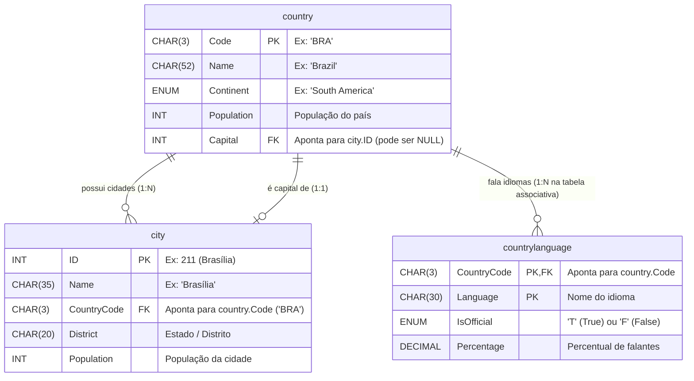
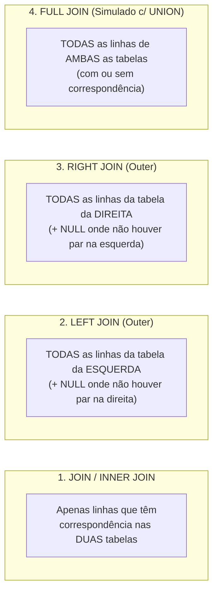

# Guia Completo e Didático de SQL (MySQL)

> **Fontes baseadas nos materiais da disciplina:**
> - `Consultas SQL - 0-sql-seleção.pdf` (*CS50 SQL — Lecture 0: Querying*, adaptado para MySQL por Prof. Flavio)
> - `Relacionando tabelas - 1-sql-relacionando.pdf` (*CS50 SQL — Lecture 1: Relating*, adaptado para MySQL por Prof. Flavio)

---

## Sumário

1. [Introdução a Bancos de Dados e SGBDs](#1-introdução-a-bancos-de-dados-e-sgbds)
2. [A Linguagem SQL e o Ambiente MySQL](#2-a-linguagem-sql-e-o-ambiente-mysql)
3. [Consultas Básicas: `SELECT`, `LIMIT` e `WHERE`](#3-consultas-básicas-select-limit-e-where)
4. [Valores Ausentes (`NULL`), Padrões (`LIKE`) e Intervalos (`BETWEEN`)](#4-valores-ausentes-null-padrões-like-e-intervalos-between)
5. [Ordenação (`ORDER BY`), Agregação, `ROUND`, `AS` e `DISTINCT`](#5-ordenação-order-by-agregação-round-as-e-distinct)
6. [Bancos de Dados Relacionais, Cardinalidade e Diagramas ER](#6-bancos-de-dados-relacionais-cardinalidade-e-diagramas-er)
7. [Chaves Primárias (`PRIMARY KEY`), Estrangeiras (`FOREIGN KEY`) e Tabelas de Junção](#7-chaves-primárias-primary-key-estrangeiras-foreign-key-e-tabelas-de-junção)
8. [Subconsultas (*Subqueries*) e o Operador `IN`](#8-subconsultas-subqueries-e-o-operador-in)
9. [Junções (`JOIN`): Combinando Tabelas Lado a Lado](#9-junções-join-combinando-tabelas-lado-a-lado)
10. [Operações de Conjuntos: `UNION`, `INTERSECT` e `EXCEPT`](#10-operações-de-conjuntos-union-intersect-e-except)
11. [Agrupamento de Dados: `GROUP BY` e `HAVING`](#11-agrupamento-de-dados-group-by-e-having)
12. [Ordem Completa das Cláusulas e Resumo Rápido (Cheat Sheet)](#12-ordem-completa-das-cláusulas-e-resumo-rápido-cheat-sheet)
13. [Atividades Práticas Resolvidas e Comentadas](#13-atividades-práticas-resolvidas-e-comentadas)

---

## 1. Introdução a Bancos de Dados e SGBDs

### 1.1 Da Tabela de Pedra à Planilha
Desde a antiguidade, a humanidade organiza dados em formato tabular. Seja em tábuas de argila, fichas de papel ou planilhas eletrônicas (Excel, Google Sheets, Apple Numbers), a estrutura fundamental é a mesma:

| Conceito | Significado | Exemplo no banco `world` |
| :--- | :--- | :--- |
| **Tabela** | Um conjunto organizado de informações sobre um mesmo tema | Tabela `country` (países) |
| **Linha (Tupla / Registro)** | Um item individual daquele conjunto | O país `Brazil` |
| **Coluna (Atributo / Campo)** | Uma característica ou propriedade de cada item | `Name`, `Continent`, `Population` |

O que mudou ao longo da história não foi o conceito de tabela, mas sim a **escala** dos dados.

### 1.2 Por que usar um Banco de Dados em vez de uma Planilha?
Um **Banco de Dados** é um conjunto organizado de dados estruturados para armazenamento e recuperação eficientes. Embora uma planilha resolva problemas pequenos, bancos de dados são indispensáveis quando precisamos de:

1. **Escala:** lidar com dezenas de milhares, milhões ou bilhões de registros sem travar.
2. **Capacidade de atualização:** suportar muitas leituras e gravações simultâneas por segundo.
3. **Velocidade:** utilizar estruturas de dados e algoritmos de busca otimizados (como índices), muito mais rápidos do que percorrer células sequencialmente com um `Ctrl + F`.

Todo sistema de banco de dados gira em torno das quatro operações fundamentais conhecidas pela sigla **CRUD**:
- **C**reate (*Criar* novos registros)
- **R**ead (*Ler* / consultar registros existentes)
- **U**pdate (*Atualizar* registros)
- **D**elete (*Excluir* registros)

### 1.3 O que é um SGBD?
Um **SGBD** (*Sistema Gerenciador de Banco de Dados* — em inglês, *DBMS*) é o software responsável por armazenar, proteger e gerenciar o banco de dados, oferecendo uma interface (gráfica ou textual) para que usuários e aplicações interajam com os dados.

- **Exemplos populares:** MySQL, PostgreSQL, SQLite, Oracle Database, Microsoft Access, MongoDB (NoSQL).
- **Como escolher um SGBD?** Três fatores principais pesam na decisão:
  1. **Custo:** soluções proprietárias (como Oracle) cobram licenças caras; soluções livres/abertas (MySQL, PostgreSQL, SQLite) são gratuitas.
  2. **Suporte:** soluções comerciais incluem suporte dedicado do fabricante; nos SGBDs livres, a instalação, configuração e manutenção ficam sob sua responsabilidade (ou de consultorias).
  3. **Peso vs. Recursos:** o **SQLite** é extremamente leve (armazena tudo em um único arquivo), enquanto **MySQL** e **PostgreSQL** operam na arquitetura cliente-servidor — são mais pesados, porém muito mais completos para sistemas multiusuário e de grande porte.

---

## 2. A Linguagem SQL e o Ambiente MySQL

### 2.1 O que é SQL?
**SQL** (*Structured Query Language* — Linguagem de Consulta Estruturada) é a linguagem padrão para interagir com bancos de dados relacionais:
- Possui sintaxe, regras e palavras-chave próprias.
- Permite **criar, ler, atualizar e excluir** dados (CRUD), sendo amplamente usada para **fazer perguntas aos dados**.
- É padronizada pela **ANSI** e pela **ISO** desde o fim dos anos 1980. Na prática, cada SGBD implementa um subconjunto do padrão e adiciona extensões próprias (formando *dialetos*, como o dialeto do MySQL, T-SQL, PL/pgSQL).

### 2.2 O Banco de Dados de Estudo: `world`
Todos os exemplos deste material utilizam o banco de dados clássico `world` do MySQL, composto por **três tabelas**:

| Tabela | Descrição | Principais Colunas |
| :--- | :--- | :--- |
| **`country`** | Países e territórios do mundo (239 linhas) | `Code`, `Name`, `Continent`, `Region`, `Population`, `LifeExpectancy`, `IndepYear`, `Capital` |
| **`city`** | Cidades ao redor do mundo (4079 linhas) | `ID`, `Name`, `CountryCode`, `District`, `Population` |
| **`countrylanguage`** | Idiomas falados em cada país | `CountryCode`, `Language`, `IsOfficial`, `Percentage` |

### 2.3 Comandos Essenciais do Cliente MySQL
Para conectar ao servidor pelo terminal Linux/macOS/Windows:

```bash
mysql -u seu_usuario -p
```

Uma vez conectado ao prompt `mysql>`, usamos comandos de administração do ambiente:

```sql
SHOW DATABASES;          -- Lista todos os bancos de dados disponíveis no servidor
USE world;               -- Seleciona o banco 'world' para uso na sessão atual
SHOW TABLES;             -- Lista todas as tabelas do banco selecionado (substitui o .tables do SQLite)
DESCRIBE country;        -- Exibe as colunas, tipos de dados, nulos e chaves da tabela (o schema)
SHOW CREATE TABLE city;  -- Exibe o comando SQL completo que criou a tabela (incluindo Foreign Keys)
```

> [!TIP]
> **Atalhos úteis no terminal do MySQL:**
> - Para sair do cliente MySQL: digite `exit` ou `quit`.
> - Para limpar a tela do terminal: pressione `Ctrl + L`.

### 2.4 Regras de Sintaxe: Strings, Identificadores, Números e Estilo

| Elemento | Como escrever no MySQL | Exemplo | Observação |
| :--- | :--- | :--- | :--- |
| **Strings (Texto)** | Aspas simples `'...'` (ou duplas `"..."`) | `'South America'` | **Prefira sempre aspas simples `'...'`**, pois é o padrão ANSI SQL aceito por todos os SGBDs. |
| **Identificadores** (tabelas/colunas) | Sem aspas ou entre **crases** (*backticks*) `` `...` `` | `` `Name` ``, `` `country` `` | Crases são opcionais para nomes simples, mas **obrigatórias** se o nome contiver espaços ou for palavra reservada. |
| **Números** | Sem aspas | `2023`, `10000000`, `70.5` | Inteiros e decimais (separados por ponto `.`). |

**Boas práticas de estilo em SQL:**
- Escreva **palavras-chave da SQL em MAIÚSCULAS** (`SELECT`, `FROM`, `WHERE`, `ORDER BY`) e nomes de tabelas/colunas conforme definidos no banco. O SQL não diferencia maiúsculas de minúsculas nas palavras-chave (`select` funciona igual a `SELECT`), mas a padronização melhora drasticamente a leitura.
- Quebre consultas longas em **várias linhas**, colocando cada cláusula principal em uma linha.
- Finalize toda instrução SQL com ponto e vírgula (`;`).

---

## 3. Consultas Básicas: `SELECT`, `LIMIT` e `WHERE`

### 3.1 `SELECT` e `FROM` — Escolhendo Colunas e Tabela
O comando `SELECT` lê dados de uma tabela indicada pela cláusula `FROM` e devolve uma **tabela de resultados**.

```sql
-- 1. Selecionar TODAS as colunas (*) da tabela country (retorna 239 linhas)
SELECT * FROM `country`;

-- 2. Selecionar apenas UMA coluna específica
SELECT `Name` FROM `country`;

-- 3. Selecionar MÚLTIPLAS colunas (separadas por vírgula)
SELECT `Name`, `Continent`, `Population` FROM `country`;
```

### 3.2 `LIMIT` — Espiando uma Amostra dos Dados
Quando uma tabela tem milhares de linhas, exibir tudo de uma vez polui a tela. A cláusula `LIMIT` restringe a quantidade de linhas retornadas:

```sql
SELECT `Name`
FROM `country`
LIMIT 10;
```

> [!NOTE]
> Sem a cláusula `ORDER BY`, o banco de dados **não garante nenhuma ordem específica** para as linhas retornadas pelo `LIMIT`.

### 3.3 `WHERE` — Filtrando Linhas por Condição
A cláusula `WHERE` filtra os dados, retornando **apenas as linhas em que a condição lógica for verdadeira**:

```sql
SELECT `Name`, `Continent`
FROM `country`
WHERE `Continent` = 'South America';
```

#### Operadores de Comparação em SQL

| Operador | Significado | Exemplo |
| :---: | :--- | :--- |
| `=` | Igual a | `Continent = 'Asia'` |
| `!=` ou `<>` | Diferente de | `Continent != 'Asia'` ou `Continent <> 'Asia'` |
| `<` | Menor que | `Population < 300` |
| `>` | Maior que | `Population > 100000000` |
| `<=` | Menor ou igual a | `IndepYear <= 1999` |
| `>=` | Maior ou igual a | `IndepYear >= 1900` |

**Três formas equivalentes de expressar "diferente de":**
```sql
WHERE `Continent` != 'Asia'
WHERE `Continent` <> 'Asia'
WHERE NOT `Continent` = 'Asia'
```

### 3.4 Operadores Lógicos (`AND`, `OR`, `NOT`) e Precedência com Parênteses
Podemos combinar várias condições no `WHERE`:
- **`AND` (E):** **todas** as condições precisam ser verdadeiras.
- **`OR` (OU):** **pelo menos uma** condição precisa ser verdadeira.
- **`NOT` (NÃO):** inverte o valor lógico da condição.

```sql
-- Países da Ásia OU da Europa
SELECT `Name`, `Continent`
FROM `country`
WHERE `Continent` = 'Asia'
   OR `Continent` = 'Europe';
```

> [!IMPORTANT]
> **Precedência de operadores (`AND` vs. `OR`):**
> Em SQL, o operador `AND` tem **precedência maior** que o `OR` (assim como a multiplicação vem antes da soma na matemática).
> Se você escrever `WHERE Continent = 'Asia' OR Continent = 'Europe' AND Population > 10000000`, o banco entenderá: *(qualquer país da Ásia, de qualquer população) OU (países da Europa com mais de 10 milhões de habitantes)*.
>
> **Use sempre parênteses `(...)`** para deixar a lógica explícita e forçar a avaliação do `OR` primeiro:

```sql
SELECT `Name`, `Continent`, `Population`
FROM `country`
WHERE (`Continent` = 'Asia' OR `Continent` = 'Europe')
  AND `Population` > 10000000;
```

---

## 4. Valores Ausentes (`NULL`), Padrões (`LIKE`) e Intervalos (`BETWEEN`)

### 4.1 `NULL` — Lidando com Dados Ausentes
Em bancos de dados, `NULL` representa um **valor desconhecido, ausente ou inaplicável** (por exemplo, territórios ou países que não têm ano de independência registrado em `IndepYear`).

> [!WARNING]
> **Armadilha clássica:** Nunca use `= NULL` ou `!= NULL`!
> Como `NULL` representa a ausência de valor, qualquer comparação direta com `=` resulta em *desconhecido* (`UNKNOWN`), e a consulta retorna **zero linhas** sem dar erro de sintaxe.
> Use obrigatoriamente **`IS NULL`** ou **`IS NOT NULL`**.

```sql
-- ERRADO (não retorna nada!):
SELECT `Name` FROM `country` WHERE `IndepYear` = NULL;

-- CORRETO: países SEM ano de independência registrado
SELECT `Name`, `IndepYear`
FROM `country`
WHERE `IndepYear` IS NULL;

-- CORRETO: países COM ano de independência registrado
SELECT `Name`, `IndepYear`
FROM `country`
WHERE `IndepYear` IS NOT NULL;
```

### 4.2 `LIKE` — Buscas por Padrões de Texto (Correspondência Aproximada)
Quando não sabemos o texto exato ou queremos buscar partes de um texto, usamos o operador `LIKE` combinado com dois **caracteres curinga (*wildcards*)**:

| Curinga | Significado | Exemplo de Padrão | O que encontra? |
| :---: | :--- | :--- | :--- |
| **`%`** | **Zero, um ou mais** caracteres quaisquer | `'%stan%'` | Qualquer nome que contenha `"stan"` em qualquer posição (*Afghanistan*, *Kazakstan*, *Pakistan*) |
| **`%`** | No final: começa com... | `'New%'` ou `'United %'` | Nomes que começam com `"New"` (*New Zealand*) ou `"United "` (*United States*, *United Kingdom*) |
| **`_`** | **Exatamente 1** caractere qualquer | `'C_%a'` | Começa com `C`, tem pelo menos 1 caractere no meio e termina com `a` (*Cuba*, *China*, *Canada*, *Colombia*) |
| **`_`** | Repetido: tamanho fixo | `'C____'` (C + 4 `_`) | Nomes com **exatamente 5 letras** começando com `C` (*Chile*, *China*, *Congo*) |

```sql
-- Países cujo nome contém 'stan'
SELECT `Name`
FROM `country`
WHERE `Name` LIKE '%stan%';
```

#### Maiúsculas e Minúsculas no MySQL (*Collation* e `BINARY`)
- No **SQLite**, o operador `=` diferencia maiúsculas de minúsculas (*case-sensitive*), enquanto o `LIKE` não diferencia.
- No **MySQL**, **tanto `=` quanto `LIKE` costumam ignorar diferenças entre maiúsculas e minúsculas** por padrão! Isso ocorre porque o comportamento depende do **collation** (regra de ordenação/comparação de caracteres) da coluna — no MySQL 8, o padrão é `utf8mb4_0900_ai_ci`, onde o sufixo `_ci` significa *case-insensitive*.
- Caso precise forçar uma comparação **sensível a maiúsculas e minúsculas** (comparando byte a byte) no MySQL, adicione a palavra-chave **`BINARY`**:

```sql
--Diferencia 'Cuba' de 'cuba' ou 'CUBA'
SELECT `Name`
FROM `country`
WHERE `Name` LIKE BINARY 'C_ba';
```

### 4.3 `BETWEEN` — Filtrando Intervalos
Para filtrar valores numéricos, datas ou textos dentro de uma faixa contínua, podemos usar `>=` e `<=` ou o operador **`BETWEEN ... AND ...`**:

```sql
-- Forma 1: Usando operadores relacionais (>= e <=)
SELECT `Name`, `IndepYear`
FROM `country`
WHERE `IndepYear` >= 1900
  AND `IndepYear` <= 1999;

-- Forma 2: Equivalente mais limpa com BETWEEN (os limites 1900 e 1999 são INCLUSIVOS!)
SELECT `Name`, `IndepYear`
FROM `country`
WHERE `IndepYear` BETWEEN 1900 AND 1999;
```

Também podemos combinar filtros em colunas inteiras e decimais (`FLOAT`/`DECIMAL`), como `LifeExpectancy`:

```sql
SELECT `Name`, `Population`, `LifeExpectancy`
FROM `country`
WHERE `Population` > 100000000
  AND `LifeExpectancy` > 70;
```

---

## 5. Ordenação (`ORDER BY`), Agregação, `ROUND`, `AS` e `DISTINCT`

### 5.1 `ORDER BY` — Ordenando os Resultados
A cláusula `ORDER BY` organiza as linhas retornadas:
- **`ASC`** (*Ascendente / Crescente*): é o **padrão** (de A a Z, ou do menor para o maior número).
- **`DESC`** (*Descendente / Decrescente*): de Z a A, ou do maior para o menor número.
- Se houver `LIMIT`, ele vem **sempre depois** do `ORDER BY`.

```sql
-- Os 10 países mais populosos do mundo (do maior para o menor)
SELECT `Name`, `Population`
FROM `country`
ORDER BY `Population` DESC
LIMIT 10;
```

#### Ordenação por Múltiplas Colunas (Critério de Desempate)
Você pode passar várias colunas no `ORDER BY`. A segunda coluna só é usada para desempatar linhas que têm o mesmo valor na primeira coluna:

```sql
-- Ordena por Continente em ordem alfabética (A-Z) e, dentro de cada continente,
-- coloca os países mais populosos primeiro (DESC)
SELECT `Name`, `Continent`, `Population`
FROM `country`
ORDER BY `Continent` ASC, `Population` DESC
LIMIT 10;
```

> [!NOTE]
> **Onde ficam os valores `NULL` no `ORDER BY` do MySQL?**
> No MySQL, os valores `NULL` são considerados menores que qualquer valor não nulo. Portanto, em uma ordenação crescente (`ASC`), **os valores `NULL` aparecem primeiro**; na decrescente (`DESC`), aparecem por último.

### 5.2 Funções de Agregação (*Aggregate Functions*)
Funções agregadas recebem um conjunto de várias linhas e **reduzem (agregam) todas elas a um único valor resumido**:

| Função | O que calcula | Exemplo na tabela `country` |
| :--- | :--- | :--- |
| **`COUNT(...)`** | Conta a quantidade de linhas / valores | `SELECT COUNT(*) FROM country;` |
| **`AVG(col)`** | Calcula a **média aritmética** (*Average*) | `SELECT AVG(Population) FROM country;` |
| **`MIN(col)`** | Encontra o **menor** valor | `SELECT MIN(Population) FROM country;` |
| **`MAX(col)`** | Encontra o **maior** valor | `SELECT MAX(Population) FROM country;` |
| **`SUM(col)`** | Calcula a **soma total** dos valores | `SELECT SUM(Population) FROM country;` |

### 5.3 `ROUND` (Arredondamento) e `AS` (Renomeando Colunas / *Alias*)
Funções como `AVG` costumam devolver números com muitas casas decimais. Podemos combinar **`ROUND(valor, casas_decimais)`** com a palavra-chave **`AS`** para dar um apelido (*alias*) legível à coluna calculada:

```sql
-- Arredonda a média para 0 casas decimais e renomeia a coluna no resultado
SELECT ROUND(AVG(`Population`), 0) AS `populacao_media`
FROM `country`;
```

> [!TIP]
> Prefira nomes de alias **sem espaços** (como `populacao_media`). Se precisar usar espaços ou acentos no cabeçalho de saída, envolva o alias em crases ou aspas: `` AS `média da população` ``.

### 5.4 Diferença Crucial: `COUNT(*)` vs. `COUNT(coluna)` e uso do `DISTINCT`
- **`COUNT(*)`** conta **todas as linhas** retornadas pela consulta, inclusive aquelas que possuem colunas com `NULL`.
- **`COUNT(coluna)`** conta **apenas as linhas em que aquela coluna NÃO é `NULL`**.

```sql
-- Conta todos os 239 países/territórios da tabela
SELECT COUNT(*) FROM `country`;

-- Conta APENAS os países que possuem ano de independência preenchido (ignora os NULL!)
SELECT COUNT(`IndepYear`) FROM `country`;
```

#### Eliminando Duplicatas com `DISTINCT`
A palavra-chave `DISTINCT` remove valores repetidos:

```sql
-- 1. Listar quais são os continentes únicos existentes na tabela
SELECT DISTINCT `Continent`
FROM `country`;

-- 2. Contar QUANTOS continentes distintos existem na tabela
SELECT COUNT(DISTINCT `Continent`) AS `total_continentes`
FROM `country`;
```

> [!CAUTION]
> **Pegadinha com `MAX` e `MIN` em colunas de texto!**
> Executar `SELECT MAX(Name) FROM country;` **NÃO** devolve o país com o nome mais comprido (com mais letras)!
> Em colunas de texto (`CHAR`/`VARCHAR`), `MIN` e `MAX` operam em **ordem alfabética**:
> - `MIN(Name)` retorna o **primeiro** nome em ordem alfabética (ex: `'Afghanistan'`).
> - `MAX(Name)` retorna o **último** nome em ordem alfabética (ex: `'Zimbabwe'`).

---

## 6. Bancos de Dados Relacionais, Cardinalidade e Diagramas ER

### 6.1 Por que não guardar tudo em uma única tabela gigante?
Imagine juntar países, cidades e idiomas em uma única planilha. Para cadastrar São Paulo, Rio de Janeiro e Salvador, teríamos de repetir `'Brazil'`, `'South America'`, `'Portuguese'` e a população do país em todas as linhas:

| Cidade | População Cidade | País | Continente |
| :--- | :--- | :--- | :--- |
| São Paulo | 9.968.485 | Brazil | South America |
| Rio de Janeiro | 5.598.953 | Brazil | South America |
| Salvador | 2.302.832 | Brazil | South America |

Isso gera **redundância de dados**, que traz dois grandes problemas:
1. **Desperdício de espaço** de armazenamento.
2. **Anomalias de atualização e inconsistência:** se um dado do país mudar, será preciso atualizar milhares de linhas de cidades.

**A solução dos Bancos Relacionais:** dividir os dados em **tabelas separadas por assunto** (`country`, `city`, `countrylanguage`) e **relacioná-las** por meio de identificadores únicos (chaves).

### 6.2 Tipos de Relacionamento (Cardinalidade)
A cardinalidade define quantas ocorrências de uma entidade podem se associar a outra. Essa escolha faz parte da **modelagem do banco de dados**:

1. **Um para Um (`1:1`):**
   - *Exemplo no `world`:* **País ↔ Capital**. Um país possui no máximo uma capital, e uma cidade é capital de no máximo um país.
2. **Um para Muitos (`1:N`):**
   - *Exemplo no `world`:* **País ↔ Cidades**. Um país possui várias cidades, mas cada cidade pertence a apenas um país.
3. **Muitos para Muitos (`N:N`):**
   - *Exemplo no `world`:* **País ↔ Idiomas**. Um país pode ter vários idiomas falados (ex: Canadá tem inglês, francês etc.), e um mesmo idioma pode ser falado em vários países (ex: português no Brasil, Portugal, Angola...).

### 6.3 Diagrama Entidade-Relacionamento (ER) e Notação Pé de Galinha (*Crow's Foot*)
Para visualizar como as tabelas se conectam, usamos o **Diagrama ER** com a notação **Pé de Galinha (*Crow's Foot*)**. As extremidades das linhas usam três símbolos básicos:

| Símbolo | Nome | Significado na Cardinalidade |
| :---: | :--- | :--- |
| **`o`** | Círculo | **Zero** (participação opcional — pode não ter nenhum) |
| **`\|`** | Traço vertical | **Um** (participação obrigatória — exatamente um / pelo menos um) |
| **`{`** ou **`<`** | Pé de galinha | **Muitos** (várias ocorrências) |



**Como ler o diagrama entre `country` e `city` (`country ||--o{ city`):**
- **Da esquerda para a direita (`country` → `city`):** Cada país tem **zero ou muitas (`o{`)** cidades cadastradas (por exemplo, a Antártida está em `country`, mas tem **zero** cidades em `city`).
- **Da direita para a esquerda (`city` → `country`):** Cada cidade pertence a **exatamente um (`||`)** país.

---

## 7. Chaves Primárias (`PRIMARY KEY`), Estrangeiras (`FOREIGN KEY`) e Tabelas de Junção

### 7.1 Chave Primária (`PRIMARY KEY` — PK)
Uma **Chave Primária** é uma coluna (ou conjunto de colunas) cujo valor **identifica de forma única cada linha de uma tabela** (como o ISBN de um livro ou o CPF de uma pessoa):
- **Nunca se repete** (valores únicos) e **nunca pode ser `NULL`**.
- Na tabela `country`, a chave primária é `Code` (código de 3 letras, como `'BRA'`, `'ARG'`, `'JPN'`).
- Na tabela `city`, a chave primária é `ID` (um número inteiro auto-incremental: `1, 2, 3...`). Chaves numéricas inteiras costumam ser preferidas porque ocupam menos espaço e são mais rápidas para indexar do que textos longos.
- Ao rodar `DESCRIBE city;`, o MySQL indica a chave primária com a sigla **`PRI`** na coluna `Key`.

### 7.2 Chave Estrangeira (`FOREIGN KEY` — FK)
Uma **Chave Estrangeira** é uma coluna em uma tabela que **guarda o valor da Chave Primária de outra tabela**, estabelecendo o elo entre elas.
- Ao contrário da chave primária, os valores de uma chave estrangeira **podem se repetir** (para representar o lado "Muitos" de um relacionamento `1:N`) e **podem ser `NULL`** (se o relacionamento for opcional).

No banco `world`, temos **duas ligações diferentes** entre `country` e `city`:
1. **Para saber a qual país uma cidade pertence (`1:N`):** a coluna `city.CountryCode` (FK) aponta para `country.Code` (PK). Várias cidades brasileiras têm `CountryCode = 'BRA'`.
2. **Para saber qual cidade é a capital de um país (`1:1`):** a coluna `country.Capital` (FK) guarda o número `city.ID` (PK) da cidade capital (ex: no registro do Brasil, `Capital = 211`, que é o `ID` de Brasília na tabela `city`). Pode ser `NULL` em territórios sem capital.

### 7.3 Relacionamento Muitos para Muitos (`N:N`) e Chave Composta
Como relacionar países e idiomas se um país fala vários idiomas e um idioma é falado em vários países? Criamos uma **tabela de junção (ou tabela associativa)** chamada `countrylanguage`:
- Ela possui uma **Chave Primária Composta** formada pelo par **`(CountryCode, Language)`**.
- Um mesmo `CountryCode` pode aparecer várias vezes (ex: `'CAN'` com `'English'` e `'CAN'` com `'French'`), e um mesmo `Language` pode aparecer várias vezes (ex: `'Portuguese'` com `'BRA'` e `'PRT'`), mas **a combinação dos dois nunca se repete** na tabela!

---

## 8. Subconsultas (*Subqueries*) e o Operador `IN`

### 8.1 O que é uma Subconsulta?
Uma **subconsulta (*subquery*)** é uma consulta `SELECT` colocada **dentro de outra consulta**, sempre envolvida por **parênteses `(...)`** e indentada para facilitar a leitura.
- **Regra de execução:** O SGBD executa **primeiro a consulta mais interna** (dentro dos parênteses) e usa o resultado dela para alimentar a consulta externa.

### 8.2 Subconsultas que Retornam um Único Valor (Usando `=`)

#### Exemplo 1: Quais são as cidades do Brasil? (Relacionamento `1:N`)
Se não sabemos de cor que o código do Brasil é `'BRA'`, pedimos para uma subconsulta descobrir o `Code` na tabela `country`:

```sql
SELECT `Name`
FROM `city`
WHERE `CountryCode` = (
    SELECT `Code`
    FROM `country`
    WHERE `Name` = 'Brazil'
);
```
1. A consulta interna roda primeiro e devolve `'BRA'`.
2. A consulta externa passa a ser `SELECT Name FROM city WHERE CountryCode = 'BRA';`.

#### Exemplo 2: Qual é a capital do Japão? E de qual país Tokyo é capital? (Relacionamento `1:1`)
```sql
-- Sentido 1: Descobrir o nome da capital do Japão
SELECT `Name`
FROM `city`
WHERE `ID` = (
    SELECT `Capital`
    FROM `country`
    WHERE `Name` = 'Japan'
);

-- Sentido 2 (caminho inverso): Tokyo é capital de qual país?
SELECT `Name`
FROM `country`
WHERE `Capital` = (
    SELECT `ID`
    FROM `city`
    WHERE `Name` = 'Tokyo'
);
```

#### Exemplo 3: Combinando Subconsulta com Função Agregada
Qual é a população média das cidades do Brasil?
```sql
SELECT ROUND(AVG(`Population`), 0) AS `media_cidades_brasil`
FROM `city`
WHERE `CountryCode` = (
    SELECT `Code`
    FROM `country`
    WHERE `Name` = 'Brazil'
);
```

#### Exemplo 4: Subconsultas em Vários Níveis (Atravessando 3 Tabelas)
Quais idiomas são falados no país cuja capital é Tokyo? (`city` → `country` → `countrylanguage`):
```sql
SELECT `Language`
FROM `countrylanguage`
WHERE `CountryCode` = (
    SELECT `Code`
    FROM `country`
    WHERE `Capital` = (
        SELECT `ID`
        FROM `city`
        WHERE `Name` = 'Tokyo'
    )
);
```
> [!TIP]
> Embora seja possível aninhar 2, 3 ou mais subconsultas, cada nível extra dificulta a leitura do código. Quando a consulta envolve várias tabelas, costuma ser mais claro usar `JOIN`.

### 8.3 O Operador `IN` — Quando a Subconsulta Retorna Várias Linhas
E se quisermos listar **os nomes dos países onde se fala português**?
Na tabela `countrylanguage`, existem **vários** países associados a `'Portuguese'` (`'AGO'`, `'BRA'`, `'CPV'`, `'GNB'`, `'MAC'`, `'MOZ'`, `'PRT'`, `'STP'`, `'TMP'`).

> [!WARNING]
> **Erro clássico no MySQL:** Se você usar o operador `=` com uma subconsulta que retorna mais de uma linha, o MySQL interromperá a execução com o erro:
> `ERROR 1242 (21000): Subquery returns more than 1 row`
>
> Quando a subconsulta puder retornar uma **lista de valores**, use sempre o operador **`IN`**!

```sql
SELECT `Name`
FROM `country`
WHERE `Code` IN (
    SELECT `CountryCode`
    FROM `countrylanguage`
    WHERE `Language` = 'Portuguese'
);
```

*(Observação: se a subconsulta não encontrar nenhuma linha, ela retorna um conjunto vazio e a consulta externa também retorna vazio, sem erro).*

---

## 9. Junções (`JOIN`): Combinando Tabelas Lado a Lado

### 9.1 Como funciona o `JOIN`?
Em vez de aninhar consultas uma dentro da outra, o **`JOIN`** costura duas (ou mais) tabelas **lado a lado** em uma tabela temporária de resultados, permitindo selecionar colunas de **ambas** as tabelas ao mesmo tempo!

- A cláusula **`ON`** especifica a condição de ligação (geralmente igualando a Chave Estrangeira de uma tabela à Chave Primária da outra).
- Quando as duas tabelas possuem colunas com o mesmo nome (ex: `country` tem `Name` e `city` também tem `Name`), usamos a notação **`tabela.coluna`** para evitar ambiguidade e **`AS`** para diferenciar no resultado:

```sql
-- Listar o nome de cada país ao lado do nome de sua respectiva capital
SELECT `country`.`Name` AS `Pais`,
       `city`.`Name`    AS `Capital`
FROM `country`
JOIN `city` ON `city`.`ID` = `country`.`Capital`
ORDER BY `Pais`
LIMIT 10;
```

### 9.2 Tipos de `JOIN` (`INNER`, `LEFT`, `RIGHT`, `FULL`)



| Tipo de Junção | Comportamento | Exemplo Prático no banco `world` |
| :--- | :--- | :--- |
| **`JOIN`** (ou **`INNER JOIN`**) | É o padrão. Mantém **somente as linhas que possuem par** nas duas tabelas. | Países que possuem capital cadastrada (territórios com `Capital IS NULL`, como a Antártida, **desaparecem** do resultado). |
| **`LEFT JOIN`** | Mantém **100% das linhas da tabela da esquerda** (a do `FROM`), mesmo que não tenham par na direita (preenchendo as colunas da direita com `NULL`). | Listar todos os países, inclusive aqueles **sem capital cadastrada** (`Capital IS NULL`). |
| **`RIGHT JOIN`** | Mantém **100% das linhas da tabela da direita** (a do `JOIN`), preenchendo a esquerda com `NULL` quando não houver par. | Listar todas as cidades da tabela `city`, mesmo aquelas que **não são capitais** de nenhum país. |
| **`FULL JOIN`** | Mantém todas as linhas da esquerda e da direita. | **Não existe comando `FULL JOIN` nativo no MySQL!** (Veja abaixo como simular com `UNION`). |

#### Exemplos Práticos de `LEFT JOIN` e `RIGHT JOIN` (Encontrando "Órfãos")

```sql
-- 1. LEFT JOIN: Quais países/territórios NÃO possuem capital cadastrada?
SELECT `country`.`Name` AS `Pais_Sem_Capital`
FROM `country`
LEFT JOIN `city` ON `city`.`ID` = `country`.`Capital`
WHERE `city`.`ID` IS NULL;

-- 2. RIGHT JOIN: Quais cidades NÃO são capitais de nenhum país?
SELECT `city`.`Name` AS `Cidade_Nao_Capital`
FROM `country`
RIGHT JOIN `city` ON `city`.`ID` = `country`.`Capital`
WHERE `country`.`Code` IS NULL
LIMIT 10;
```

#### Como fazer `FULL JOIN` no MySQL?
Como o MySQL não possui `FULL OUTER JOIN`, basta unir um `LEFT JOIN` e um `RIGHT JOIN` usando o operador `UNION`:

```sql
SELECT `country`.`Name` AS `Pais`, `city`.`Name` AS `Capital`
FROM `country` LEFT JOIN `city` ON `city`.`ID` = `country`.`Capital`
UNION
SELECT `country`.`Name` AS `Pais`, `city`.`Name` AS `Capital`
FROM `country` RIGHT JOIN `city` ON `city`.`ID` = `country`.`Capital`;
```

### 9.3 Duas Armadilhas Perigosas com `JOIN` no MySQL

> [!DANGER]
> **1. Nunca use `NATURAL JOIN` entre tabelas como `country` e `city`!**
> O `NATURAL JOIN` tenta adivinhar a junção comparando automaticamente **todas as colunas que possuem o mesmo nome** nas duas tabelas. Em `country` e `city`, a coluna de mesmo nome é `Name`! Ou seja, `country NATURAL JOIN city` vai juntar países e cidades que têm o **mesmo nome** (como *Singapore* ou *Djibouti*), e não pela chave estrangeira! **Escreva sempre a condição explícita com `ON`.**
>
> **2. Nunca esqueça a cláusula `ON` em um `JOIN` no MySQL!**
> Em outros bancos, `JOIN` sem `ON` gera erro de sintaxe. No **MySQL**, um `JOIN` sem `ON` é válido e executa um **`CROSS JOIN` (Produto Cartesiano)**: ele combina cada um dos 239 países com todas as 4.079 cidades ($239 \times 4.079 = 974.881$ linhas sem sentido!).

---

## 10. Operações de Conjuntos: `UNION`, `INTERSECT` e `EXCEPT`

Enquanto o `JOIN` combina colunas de tabelas **horizontalmente (lado a lado)**, as operações de conjuntos combinam os resultados de duas consultas `SELECT` **verticalmente (empilhando linhas)**.

> [!IMPORTANT]
> **Regra obrigatória para operações de conjuntos:**
> Todas as consultas combinadas devem retornar **exatamente o mesmo número de colunas** e com **tipos de dados compatíveis** na mesma ordem.

| Operador | Conceito na Teoria dos Conjuntos | O que retorna? | Exemplo no banco `world` |
| :--- | :--- | :--- | :--- |
| **`UNION`** | União ($A \cup B$) | Linhas que estão na 1ª consulta **OU** na 2ª consulta (remove duplicatas automaticamente). | Nomes que existem como cidade **ou** como país. |
| **`INTERSECT`** | Interseção ($A \cap B$) | Apenas linhas que aparecem **NAS DUAS** consultas simultaneamente. | Nomes que são ao mesmo tempo nome de cidade **e** nome de país (ex: *Singapore*, *Djibouti*). |
| **`EXCEPT`** | Diferença ($A - B$) | Linhas que estão na 1ª consulta, **MAS NÃO** estão na 2ª consulta. | Nomes de países que **nunca** aparecem como nome de cidade. |

### 10.1 Exemplos com `UNION`, `INTERSECT` e `EXCEPT`

```sql
-- 1. UNION: Todos os nomes de cidades e países em uma única lista (sem repetição)
SELECT `Name` FROM `city`
UNION
SELECT `Name` FROM `country`;

-- Dica: Para saber de qual tabela veio cada linha no UNION, crie uma coluna literal fixa:
SELECT 'cidade' AS `tipo`, `Name` FROM `city`
UNION
SELECT 'pais'   AS `tipo`, `Name` FROM `country`;

-- 2. INTERSECT: Países onde se fala Inglês E TAMBÉM se fala Francês
SELECT `CountryCode` FROM `countrylanguage` WHERE `Language` = 'English'
INTERSECT
SELECT `CountryCode` FROM `countrylanguage` WHERE `Language` = 'French';

-- 3. EXCEPT: Nomes que são de países, mas NÃO existem como nome de nenhuma cidade
SELECT `Name` FROM `country`
EXCEPT
SELECT `Name` FROM `city`;
```

### 10.2 Compatibilidade de Versão no MySQL (`8.0.31+`) e Equivalentes com `IN` / `NOT IN`
Os operadores **`INTERSECT`** e **`EXCEPT`** foram adicionados ao MySQL apenas na versão **8.0.31** (você pode checar sua versão rodando `SELECT VERSION();`). Em versões mais antigas do MySQL, reescrevemos essas consultas com subconsultas:

```sql
-- Equivalente ao INTERSECT em qualquer versão do MySQL (usando IN + DISTINCT):
SELECT DISTINCT `Name`
FROM `city`
WHERE `Name` IN (
    SELECT `Name` FROM `country`
);

-- Equivalente ao EXCEPT em qualquer versão do MySQL (usando NOT IN):
SELECT `Name`
FROM `country`
WHERE `Name` NOT IN (
    SELECT `Name` FROM `city`
);
```

> [!WARNING]
> **Armadilha mortal do `NOT IN` com `NULL`:**
> Se a subconsulta dentro de um `NOT IN (...)` retornar **qualquer valor `NULL`** em sua lista, a expressão inteira será avaliada como desconhecida (`UNKNOWN`) e a consulta principal **retornará zero linhas silenciosamente**! Se a coluna da subconsulta permitir `NULL`, filtre-a com `WHERE coluna IS NOT NULL` dentro da subconsulta.

---

## 11. Agrupamento de Dados: `GROUP BY` e `HAVING`

### 11.1 `GROUP BY` — Agrupando Linhas para Calcular Agregações por Categoria
Vimos que `SELECT COUNT(*) FROM city;` devolve um único número para a tabela inteira. Mas e se quisermos saber **quantas cidades cada país tem** ou **qual é a população média das cidades de cada país**?

A cláusula **`GROUP BY`** reúne todas as linhas que têm o mesmo valor na coluna informada em um único grupo e aplica a função de agregação (`COUNT`, `AVG`, `SUM`, `MIN`, `MAX`) para cada grupo separadamente:

```sql
-- 1. Contar quantas cidades existem em cada país (identificado por CountryCode)
SELECT `CountryCode`,
       COUNT(*) AS `total_cidades`
FROM `city`
GROUP BY `CountryCode`;

-- 2. Calcular a população média das cidades por país
SELECT `CountryCode`,
       ROUND(AVG(`Population`), 0) AS `media_populacao_urbana`
FROM `city`
GROUP BY `CountryCode`;
```

### 11.2 `HAVING` — Filtrando Grupos (A Diferença entre `WHERE` e `HAVING`)
Um erro muito comum é tentar usar funções agregadas dentro do `WHERE` (ex: `WHERE COUNT(*) > 20` — **isso dá erro de sintaxe!**). Por quê?

| Cláusula | Quando atua? | O que ela filtra? | Pode usar funções agregadas (`COUNT`, `AVG`...)? |
| :--- | :--- | :--- | :---: |
| **`WHERE`** | **Antes** do `GROUP BY` | Filtra **linhas individuais** da tabela bruta | **NÃO** |
| **`HAVING`** | **Depois** do `GROUP BY` | Filtra **grupos já formados** pelo `GROUP BY` | **SIM** |

```sql
-- Mostrar a expectativa de vida média por continente,
-- mas APENAS para os continentes cuja média de vida seja superior a 70 anos:
SELECT `Continent`,
       ROUND(AVG(`LifeExpectancy`), 2) AS `media_vida`
FROM `country`
GROUP BY `Continent`
HAVING `media_vida` > 70;
```

> [!NOTE]
> **Particularidade do MySQL no `HAVING` e `ONLY_FULL_GROUP_BY`:**
> 1. O MySQL permite usar o **alias** definido no `SELECT` (como `HAVING media_vida > 70`) diretamente na cláusula `HAVING`. Em outros SGBDs mais estritos (como PostgreSQL), é obrigatório repetir a função agregada: `HAVING AVG(LifeExpectancy) > 70`.
> 2. No MySQL moderno, o modo **`ONLY_FULL_GROUP_BY`** vem ativo por padrão: toda coluna listada no `SELECT` deve obrigatoriamente **estar no `GROUP BY`** ou **estar dentro de uma função de agregação**.

---

## 12. Ordem Completa das Cláusulas e Resumo Rápido (Cheat Sheet)

Quando você escreve uma consulta SQL combinando vários recursos, **a ordem das cláusulas na escrita é fixa e obrigatória**. Trocar a ordem (por exemplo, colocar `WHERE` depois de `GROUP BY` ou `LIMIT` antes de `ORDER BY`) causa erro de sintaxe!

```sql
SELECT `coluna1`, FUNCAO_AGREGADA(`coluna2`) AS `apelido`
FROM `tabela_A`
JOIN `tabela_B` ON `tabela_A`.`fk` = `tabela_B`.`pk`
WHERE `condicao_nas_linhas_individuais`
GROUP BY `coluna1`
HAVING `condicao_nos_grupos_agregados`
ORDER BY `apelido` DESC
LIMIT 10;
```

### Fluxo Lógico de uma Consulta SQL


---

## 13. Atividades Práticas Resolvidas e Comentadas

Abaixo estão todas as questões práticas propostas nos slides das duas aulas (incluindo o desafio de conjuntos), com suas respectivas soluções em SQL comentadas passo a passo.

---

### Parte A — Exercícios da Aula 1 (`Consultas SQL - 0-sql-seleção.pdf`, Slide 32)

#### 1. Liste os países com população superior a 50 milhões.
```sql
SELECT `Name`, `Population`
FROM `country`
WHERE `Population` > 50000000
ORDER BY `Population` DESC;
```
- **Explicação:** Filtramos a coluna numérica `Population` usando o operador `>` com o inteiro `50000000` (sem pontos nem aspas). O `ORDER BY` é opcional, mas ajuda a visualizar do maior para o menor.

#### 2. Encontre países cujo nome começa com "S".
```sql
SELECT `Name`
FROM `country`
WHERE `Name` LIKE 'S%';
```
- **Explicação:** O operador `LIKE` combinado com `'S%'` exige que o primeiro caractere seja `'S'` seguido por zero ou mais caracteres quaisquer (`%`).

#### 3. Quais países não têm ano de independência registrado?
```sql
SELECT `Name`, `IndepYear`
FROM `country`
WHERE `IndepYear` IS NULL;
```
- **Explicação:** Dados ausentes são representados por `NULL` e devem ser testados exclusivamente com `IS NULL` (nunca com `= NULL`).

#### 4. Liste os 10 países mais populosos, em ordem decrescente.
```sql
SELECT `Name`, `Population`
FROM `country`
ORDER BY `Population` DESC
LIMIT 10;
```
- **Explicação:** Ordenamos pela coluna `Population` de forma decrescente (`DESC`) e aplicamos `LIMIT 10` ao final para pegar apenas os 10 primeiros colocados.

---

### Parte B — Desafio de Conjuntos (`Relacionando tabelas - 1-sql-relacionando.pdf`, Slide 25)

#### Desafio: Encontrar nomes que existem APENAS como país ou APENAS como cidade, mas NÃO como ambos (Diferença Simétrica $A \triangle B$).
```sql
-- Solução 1 (MySQL 8.0.31+): Unindo os dois EXCEPTs com parênteses
(SELECT `Name` FROM `country` EXCEPT SELECT `Name` FROM `city`)
UNION
(SELECT `Name` FROM `city` EXCEPT SELECT `Name` FROM `country`);

-- Solução 2 (Equivalente: (A UNION B) EXCEPT (A INTERSECT B)):
(SELECT `Name` FROM `country` UNION SELECT `Name` FROM `city`)
EXCEPT
(SELECT `Name` FROM `country` INTERSECT SELECT `Name` FROM `city`);
```
- **Explicação:** Queremos todos os nomes menos aqueles que pertencem à interseção das duas tabelas. Podemos unir `(Países - Cidades)` com `(Cidades - Países)` ou tirar a interseção da união total.

---

### Parte C — Exercícios da Aula 2 (`Relacionando tabelas - 1-sql-relacionando.pdf`, Slide 32)

#### 1. Liste as cidades da Argentina usando subconsulta e depois com `JOIN`.

**Com Subconsulta:**
```sql
SELECT `Name`, `District`, `Population`
FROM `city`
WHERE `CountryCode` = (
    SELECT `Code`
    FROM `country`
    WHERE `Name` = 'Argentina'
);
```

**Com `JOIN`:**
```sql
SELECT `city`.`Name` AS `Cidade`,
       `city`.`District` AS `Distrito`,
       `city`.`Population` AS `Populacao`
FROM `city`
JOIN `country` ON `city`.`CountryCode` = `country`.`Code`
WHERE `country`.`Name` = 'Argentina';
```
- **Explicação:** Na subconsulta, descobrimos primeiro o `Code` da Argentina (`'ARG'`) e filtramos `city`. No `JOIN`, ligamos `city.CountryCode` a `country.Code` e filtramos por `country.Name = 'Argentina'`.

#### 2. Quais países falam espanhol como idioma oficial (`IsOfficial = 'T'`)?

**Com `JOIN`:**
```sql
SELECT `country`.`Name` AS `Pais`,
       `countrylanguage`.`Percentage` AS `Percentual_Falantes`
FROM `country`
JOIN `countrylanguage` ON `country`.`Code` = `countrylanguage`.`CountryCode`
WHERE `countrylanguage`.`Language` = 'Spanish'
  AND `countrylanguage`.`IsOfficial` = 'T'
ORDER BY `Pais`;
```

**Com Subconsulta (`IN`):**
```sql
SELECT `Name` AS `Pais`
FROM `country`
WHERE `Code` IN (
    SELECT `CountryCode`
    FROM `countrylanguage`
    WHERE `Language` = 'Spanish'
      AND `IsOfficial` = 'T'
)
ORDER BY `Pais`;
```
- **Explicação:** Filtramos a tabela `countrylanguage` exigindo simultaneamente `Language = 'Spanish'` **E** (`AND`) `IsOfficial = 'T'`. Como há vários países hispanofalantes, a versão com subconsulta precisa usar `IN`.

#### 3. Liste o nome do país e o nome da capital para a Europa (`Continent = 'Europe'`).
```sql
SELECT `country`.`Name` AS `Pais`,
       `city`.`Name`    AS `Capital`
FROM `country`
JOIN `city` ON `city`.`ID` = `country`.`Capital`
WHERE `country`.`Continent` = 'Europe'
ORDER BY `Pais`;
```
- **Explicação:** Como precisamos exibir colunas das **duas** tabelas lado a lado (`country.Name` e `city.Name`), o `JOIN` é a ferramenta ideal. Atenção à condição de junção: para encontrar a **capital**, ligamos `city.ID = country.Capital` (e não `CountryCode`, que traria todas as cidades europeias!).

#### 4. Quantos países existem por continente? Mostre só os continentes com mais de 20 países.
```sql
SELECT `Continent`,
       COUNT(*) AS `total_paises`
FROM `country`
GROUP BY `Continent`
HAVING `total_paises` > 20
ORDER BY `total_paises` DESC;
```
- **Explicação:** Agrupamos os países por `Continent` (`GROUP BY Continent`), contamos quantas linhas caíram em cada grupo (`COUNT(*)`) e usamos `HAVING` (nunca `WHERE`!) para filtrar apenas os grupos cuja contagem ultrapassa 20.

#### 5. Quais idiomas são falados em mais de 30 países?
```sql
SELECT `Language`,
       COUNT(`CountryCode`) AS `total_paises`
FROM `countrylanguage`
GROUP BY `Language`
HAVING `total_paises` > 30
ORDER BY `total_paises` DESC;
```
- **Explicação:** Na tabela `countrylanguage`, cada linha representa a presença de um idioma em um país (pois a chave primária composta é `(CountryCode, Language)`). Ao agrupar por `Language` e contar os países com `COUNT(CountryCode)` (ou `COUNT(*)`), filtramos os grupos com `HAVING total_paises > 30` (retornando *English*, *Arabic*, *Spanish* e *French*).
